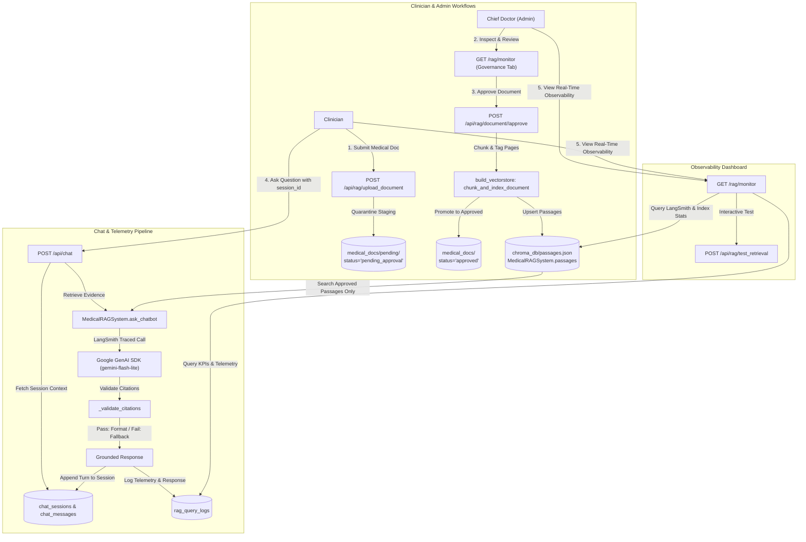

# Clinical RAG Monitor, Document Governance & Multi-Session Chat Implementation Plan

## Goal Description
Build an enterprise-grade **Clinical RAG Observability & Document Governance System** for NeuroMed AI. This system addresses three interconnected clinical requirements:
1. **RAG Monitor & Observability Dashboard**: Real-time transparency into how the Wilson Disease RAG system retrieves evidence, validates citations, routes queries between Gemini (with LangSmith tracing) and deterministic extractive synthesis, and ensures zero clinical hallucination.
2. **Clinician Document Ingestion with Chief Doctor (Admin) Authorization**: Enable clinicians to submit new clinical guidelines or hospital protocols into a quarantined staging state. The document **cannot be accessed or retrieved by the RAG bot until the Chief Doctor (Admin)** reviews and explicitly approves it. Upon approval, it is automatically chunked into page-tagged passages and ingested into the active RAG index.
3. **Multi-Session Chat Persistence & History**: Replace ephemeral single-page chat arrays with database-backed conversation sessions. Each chatbot interaction is stored in a distinct session (`session_id`). Clinicians can switch between past conversations, start new chats, and resume prior discussions with full context and voice playback.



---

## User Review Required

> [!IMPORTANT]
> **Chief Doctor (Admin) Authorization Invariant**:
> Newly uploaded documents will **never** be included in RAG retrieval or citation validation while in `pending_approval` or `rejected` state. Only when an Admin (Chief Doctor) clicks "Approve" is the document promoted to `medical_docs/`, chunked into `[Source: <filename> | Page: <page>]` passages, and dynamically registered in `MedicalRAGSystem`.

> [!NOTE]
> **Backward Compatibility for Existing Report Chat**:
> Existing chat callers in `templates/result.html` will seamlessly generate or reuse `session_id` in local storage or URL query parameters, preserving existing voice reading and patient context without breaking changes.

---

## Open Questions

> [!TIP]
> 1. **Document File Types**: Should clinician document uploads support `.pdf`, `.docx`, and `.txt` (recommended), or strictly `.pdf`?
> 2. **Session Titling**: Should new chat sessions automatically title themselves based on the first user query (e.g., "Trientine dosing in pediatric patients")?
> 3. **Chief Doctor Rejection Notes**: When the Chief Doctor rejects a document, should they be prompted for an optional reason visible to the submitting clinician?

---

## Proposed Changes

### 1. Database Layer (`database.py`)

#### [MODIFY] `database.py`
Add schemas for Document Governance, RAG Telemetry, and Multi-Session Chat:

1. **`rag_documents` (Document Governance Table)**:
   ```sql
   CREATE TABLE IF NOT EXISTS rag_documents (
       doc_id INTEGER PRIMARY KEY AUTOINCREMENT,
       filename TEXT NOT NULL UNIQUE,
       original_filename TEXT NOT NULL,
       title TEXT NOT NULL,
       file_path TEXT NOT NULL,
       file_size_bytes INTEGER NOT NULL,
       file_hash_sha256 TEXT NOT NULL,
       uploaded_by_id INTEGER,
       uploaded_by_name TEXT,
       review_status TEXT NOT NULL DEFAULT 'pending_approval' CHECK(review_status IN ('pending_approval', 'approved', 'rejected')),
       reviewed_by_id INTEGER,
       reviewed_by_name TEXT,
       review_notes TEXT,
       passages_count INTEGER DEFAULT 0,
       created_at TIMESTAMP DEFAULT CURRENT_TIMESTAMP,
       reviewed_at TIMESTAMP,
       FOREIGN KEY (uploaded_by_id) REFERENCES users(user_id) ON DELETE SET NULL,
       FOREIGN KEY (reviewed_by_id) REFERENCES users(user_id) ON DELETE SET NULL
   );
   ```

2. **`chat_sessions` (Persistent Chat Sessions Table)**:
   ```sql
   CREATE TABLE IF NOT EXISTS chat_sessions (
       session_id TEXT PRIMARY KEY,
       user_id INTEGER NOT NULL,
       username TEXT NOT NULL,
       title TEXT NOT NULL,
       patient_id TEXT,
       created_at TIMESTAMP DEFAULT CURRENT_TIMESTAMP,
       updated_at TIMESTAMP DEFAULT CURRENT_TIMESTAMP,
       FOREIGN KEY (user_id) REFERENCES users(user_id) ON DELETE CASCADE
   );
   ```

3. **`chat_messages` (Turn-by-Turn History Table)**:
   ```sql
   CREATE TABLE IF NOT EXISTS chat_messages (
       message_id INTEGER PRIMARY KEY AUTOINCREMENT,
       session_id TEXT NOT NULL,
       role TEXT NOT NULL CHECK(role IN ('user', 'assistant')),
       content TEXT NOT NULL,
       citations_json TEXT,
       synthesis_engine TEXT,
       created_at TIMESTAMP DEFAULT CURRENT_TIMESTAMP,
       FOREIGN KEY (session_id) REFERENCES chat_sessions(session_id) ON DELETE CASCADE
   );
   ```

4. **`rag_query_logs` (Telemetry & Quality Audit Table)**:
   ```sql
   CREATE TABLE IF NOT EXISTS rag_query_logs (
       log_id INTEGER PRIMARY KEY AUTOINCREMENT,
       user_id INTEGER,
       username TEXT,
       session_id TEXT,
       query_text TEXT NOT NULL,
       response_text TEXT NOT NULL,
       synthesis_engine TEXT NOT NULL,
       citation_valid INTEGER NOT NULL DEFAULT 1,
       fallback_reason TEXT,
       retrieved_passages_count INTEGER DEFAULT 0,
       sources_cited_json TEXT,
       latency_ms REAL,
       created_at TIMESTAMP DEFAULT CURRENT_TIMESTAMP,
       FOREIGN KEY (user_id) REFERENCES users(user_id) ON DELETE SET NULL,
       FOREIGN KEY (session_id) REFERENCES chat_sessions(session_id) ON DELETE SET NULL
   );
   ```

5. **Helper Functions to Add**:
   - `create_rag_document_submission(data, db_path) -> int`
   - `get_rag_documents(status=None, db_path) -> List[Dict]`
   - `update_rag_document_status(doc_id, status, reviewer_id, reviewer_name, notes, db_path) -> bool`
   - `create_or_get_chat_session(session_id, user_id, username, title, patient_id, db_path) -> Dict`
   - `get_user_chat_sessions(user_id, db_path) -> List[Dict]`
   - `add_chat_message(session_id, role, content, citations, engine, db_path) -> int`
   - `get_chat_session_messages(session_id, db_path) -> List[Dict]`
   - `log_rag_query(query_data, db_path) -> int`
   - `get_rag_metrics_summary(db_path) -> Dict`

---

### 2. Clinical RAG Engine (`rag_system.py`)

#### [MODIFY] `rag_system.py`
1. **Dynamic Approved Document Registration**:
   - Refactor `APPROVED_PDFS` into a dynamic instance set `self.approved_docs` seeded with the original 4 approved PDF guidelines + any documents with `review_status = 'approved'` in the database.
   - Add method `register_approved_document(pdf_name: str, new_passages: list)`:
     - Adds `pdf_name` to `self.approved_docs`.
     - Extends `self.passages` in memory so that live queries can retrieve and cite it immediately without restarting the web server.
2. **Chunking & Page Extraction Utility**:
   - Provide `ingest_pdf_document(file_path: str, filename: str) -> List[str]`:
     - Reads pages using `pypdf.PdfReader`.
     - Extracts chunks tagged with `[Source: <filename> | Page: <page>]`.
     - Returns passage list and appends to `chroma_db/passages.json`.
3. **Structured Telemetry Output**:
   - Implement `ask_chatbot_with_telemetry(user_question, patient_context=None, chat_history=None) -> Tuple[str, Dict]`:
     - Measures `latency_ms`.
     - Captures `retrieved_passages` (sources, pages, previews).
     - Identifies `synthesis_engine` (`gemini` vs `extractive`).
     - Reports `citation_valid` and `fallback_reason`.
   - Maintain `ask_chatbot(...)` signature for full backward compatibility.

---

### 3. Application Routes & APIs (`app.py`)

#### [MODIFY] `app.py`

1. **Document Upload & Approval Gatekeeper**:
   - `@app.route("/api/rag/upload_document", methods=["POST"])` `@roles_required("clinician")`:
     - Validates uploaded file (PDF, docx, txt; max 25MB, secure filename).
     - Calculates SHA-256 hash to prevent duplicate submissions.
     - Saves in `medical_docs/pending/`.
     - Inserts record into `rag_documents` with `review_status = 'pending_approval'`.
     - Records audit log: `RAG_DOC_SUBMITTED`.
   - `@app.route("/api/rag/document/<int:doc_id>/approve", methods=["POST"])` `@roles_required("admin")`:
     - Chief Doctor (Admin) only!
     - Moves file from `medical_docs/pending/` to `medical_docs/`.
     - Ingests passages with page headers.
     - Calls `rag_assistant.register_approved_document(filename, new_passages)`.
     - Updates status to `'approved'` and saves `passages_count`.
     - Records audit log: `RAG_DOC_APPROVED`.
   - `@app.route("/api/rag/document/<int:doc_id>/reject", methods=["POST"])` `@roles_required("admin")`:
     - Chief Doctor only!
     - Updates status to `'rejected'` with reason.
     - Leaves file quarantined or cleans up.
     - Records audit log: `RAG_DOC_REJECTED`.

2. **Multi-Session Chat API**:
   - `@app.route("/api/chat/sessions", methods=["GET"])` `@roles_required("clinician")`:
     - Returns list of past sessions for the logged-in user.
   - `@app.route("/api/chat/session/<session_id>", methods=["GET"])` `@roles_required("clinician")`:
     - Returns full message history for the requested session.
   - `@app.route("/api/chat/new_session", methods=["POST"])` `@roles_required("clinician")`:
     - Initializes a new chat session and returns `session_id`.
   - `@app.route("/api/chat", methods=["POST"])` `@roles_required("clinician")`:
     - Receives `message`, optional `session_id`, `patient_context`.
     - If `session_id` is missing/new, automatically creates a session.
     - Appends user message to `chat_messages`.
     - Fetches recent messages from `chat_messages` to supply context to `ask_chatbot_with_telemetry`.
     - Saves assistant response with verified citations and synthesis engine.
     - Logs query telemetry into `rag_query_logs`.
     - Returns JSON `{"response": reply, "session_id": session_id}`.

3. **RAG Observability & Governance Dashboard**:
   - `@app.route("/rag/monitor", methods=["GET"])` `@roles_required("clinician")`:
     - Collects real-time telemetry metrics (`get_rag_metrics_summary`).
     - Collects pending and approved documents (`get_rag_documents`).
     - Collects LangSmith configuration status.
     - Renders `templates/rag_monitor.html`.
   - `@app.route("/api/rag/test_retrieval", methods=["POST"])` `@roles_required("clinician")`:
     - Live retrieval diagnostic endpoint for testing queries and inspecting passage ranking.

---

### 4. User Interface (`templates/rag_monitor.html` & Chat Drawer)

#### [NEW] `templates/rag_monitor.html`
A comprehensive, responsive dashboard featuring 4 clinical tabs:
1. **Overview & Health Metrics**:
   - KPI Cards: Total Queries, Citation Pass Rate (%), Fallback Rate (%), Average Latency (ms), Active Guidelines Count.
   - Engine Status: Gemini (`gemini-flash-lite-latest` via Google GenAI SDK), LangSmith Tracing Active indicator, Vectorstore Passage Count (1,165+).
   - Guideline Distribution Chart: Citation share across AASLD, EASL-ERN, NIH, and newly approved hospital guidelines.
2. **Medical Document Governance (Chief Doctor Portal)**:
   - **Clinician Upload Zone**: Drag-and-drop submission for new clinical papers/guidelines.
   - **Pending Review Table (Chief Doctor Action)**:
     - Shows Document Title, Submitting Clinician, Date, File Size.
     - Action buttons for Admin: **Approve & Ingest to RAG** | **Reject**.
   - **Active Knowledge Base Table**:
     - Lists all approved documents currently active in the RAG bot, with passage counts and approval dates.
3. **Live Query Audit Trail**:
   - Table of all clinical queries with clinician name, timestamp, synthesis engine badge (`Gemini (Verified)` vs `Extractive Synthesis`), and citation status.
   - Expandable drawer to view exact retrieved passages, page numbers, and prompt context.
4. **Interactive Retrieval Inspector**:
   - Test search box allowing clinicians to test sample questions and see the scored passages and guideline diversification in real time.

#### [MODIFY] `templates/result.html` & Chat Drawer
Enhance the chatbot widget with a clean session history panel:
- `+ New Chat` button.
- Slide-out list of past chat conversations with date and title.
- Seamless resumption of previous chats with full message history and voice reading (`🔊 Read Aloud`).

---

### 5. Automated Test Suite (`tests/test_rag_monitor.py`)

#### [NEW] `tests/test_rag_monitor.py`
Comprehensive test suite verifying:
1. **Document Submission & Authorization Workflow**:
   - Clinician uploads document -> verified in `pending_approval` state.
   - Non-admin cannot approve document (403 Forbidden).
   - Admin (Chief Doctor) approves document -> document ingested and registered into RAG knowledge base.
   - Unapproved/rejected documents are strictly excluded from RAG retrieval.
2. **Multi-Session Chat Persistence**:
   - Creating a new session, persisting messages, and loading history.
   - Multi-turn conversation preserves previous context within the session.
   - Switching between sessions isolates conversation histories.
3. **RAG Telemetry & Dashboard**:
   - Verification of `rag_query_logs` recording on `/api/chat`.
   - KPI metrics calculation (pass rate, latency).
   - Route protection: `/rag/monitor` accessible to clinicians/admins, forbidden to unauthenticated/unauthorized users.

---

## Verification Plan

### Automated Tests
```powershell
# 1. Run new RAG monitor, document governance, and chat session tests
python -m unittest tests/test_rag_monitor.py -v

# 2. Run RAG guideline exclusivity tests
python -m unittest tests/test_rag_guideline_exclusive.py -v

# 3. Run full project test suite
python -m unittest discover -s tests -p "test_*.py" -v
```

### Manual Verification
1. **Clinician Upload**: Log in as clinician (`dr_smith`), go to `/rag/monitor`, upload a sample medical protocol. Verify status shows `Pending Approval`.
2. **RAG Bot Exclusion**: Ask the chatbot about a topic exclusive to the pending document; verify the bot states the documents lack sufficient evidence.
3. **Chief Doctor Approval**: Log in as Admin (`root_admin`), navigate to the Governance tab in `/rag/monitor`, and click "Approve & Ingest". Verify passages are extracted and status updates to `Approved`.
4. **RAG Bot Access**: Re-ask the question; verify the bot now retrieves, answers, and cites the newly approved document with its page number.
5. **Chat Session History**: In the chat widget, start a new chat, ask questions, reload the page, and verify the previous conversation session appears in the history sidebar and can be resumed with full context.
