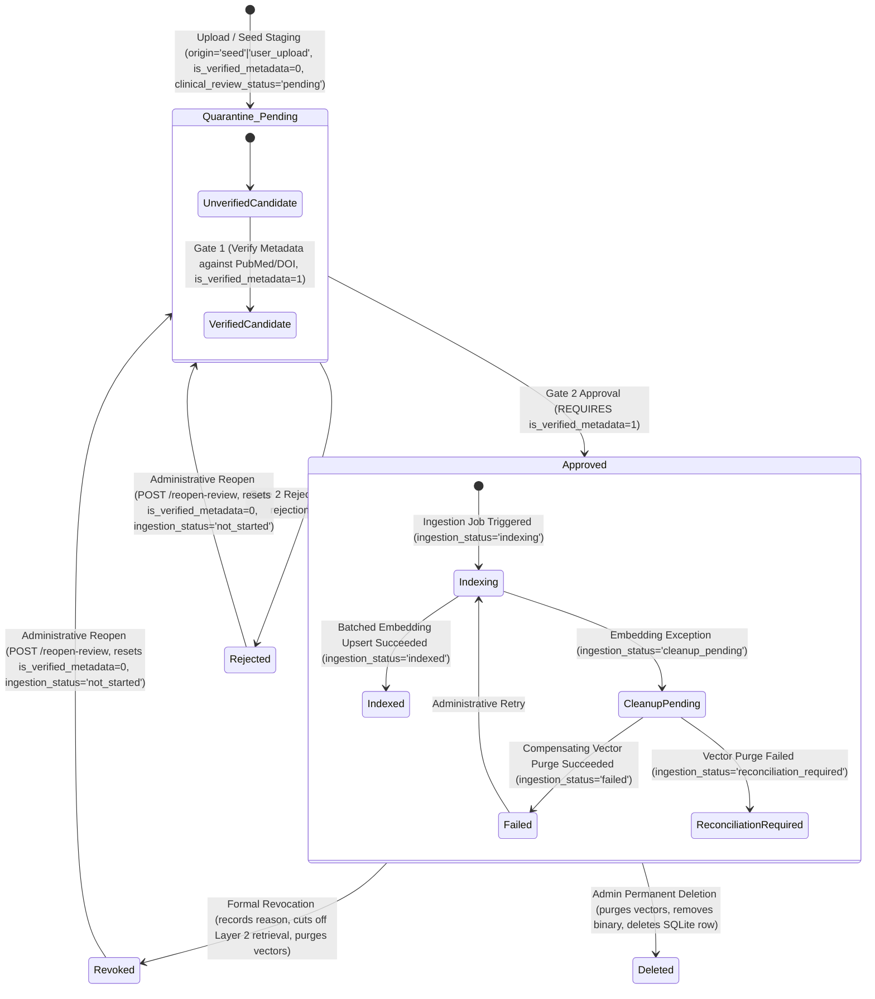
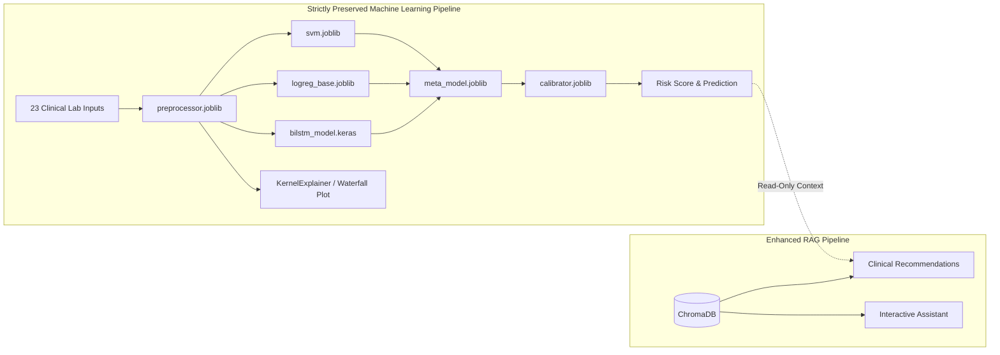

# 🏥 Technical Design Document: Robust Medical Evidence RAG & Clinician Verification Portal for Wilson's Disease

**Specification**: NeuroMed AI — Wilson's Disease Source-Grounded Medical Evidence RAG System
**Document Path**: `specs/rag-enhancement/design.md`
**Phase**: Phase 3 — Spec-Driven Development (SDD) Technical Design
**Status**: Completed Design Specification — Pending User Review
**Date**: October 12, 2026
**Target Milestone**: v3.0.0-production-rag-hms
**Requirements Reference**: [`specs/rag-enhancement/requirements.md`](file:///c:/Users/LENOVO/OneDrive/Desktop/Wilson-Disease-Project-main/Wilson-Disease-Project-main/Wilson-Disease-Project-main/specs/rag-enhancement/requirements.md)

---

## 1. Executive Summary & Design Scope

This Technical Design Document specifies the production architecture for the **Wilson's Disease Source-Grounded Medical Evidence RAG System** in **NeuroMed AI**.

It incorporates the three confirmed design decisions from project stakeholders:
* **DEC-01 (Hybrid Synthesis Engine)**: LLM answer synthesis (Gemini 1.5 Flash / OpenAI) when available, coupled with a deterministic, zero-dependency **Extractive Fallback** when LLM services are unavailable or unconfigured.
* **DEC-02 (Interactive Citation UI)**: Inline clickable citation badges `[1]`, `[2]` embedded in the chat response that open an interactive, expandable **Evidence Drawer** showing the document title, authors, year, DOI, page number, section heading, and exact quoted excerpt.
* **DEC-03 (Admin-Controlled Researcher Accounts & Strict Approval Gate)**: Researcher accounts are provisioned exclusively by Administrators. All contributed documents are quarantined and must be inspected and approved by an authorized Chief Clinician or Administrator before any text chunks enter the active ChromaDB vector index.

This design strictly isolates the RAG system from the existing supervised machine learning ensemble, ensuring zero interference with Wilson's Disease risk predictions, probability calibration, or SHAP explainability.

---

## 2. Baseline Architecture, Confirmed Decisions, and Unresolved Technical Issues

### 2.1 Repository Inspection Baseline (Observed Snapshot as of October 2026 Audit)
> [!NOTE]
> The following observations reflect the verified repository state at the time of the Phase 1 audit. They represent an empirical snapshot rather than permanent runtime guarantees.

1. **Document Assets**: `medical_docs/` currently contains four authentic clinical guideline PDFs:
   - `AASLD WD Guidelines.pdf` (~2.08 MB)
   - `EASL-ERN Clinical Practice Guidelines on Wilson's disease.pdf` (~1.65 MB)
   - `NIH Wilson Disease.pdf` (~577 KB)
   - `clinical practice guidelines in WD.pdf` (~3.09 MB)
2. **Missing Legacy Directory**: `medical_docs_backup/` does not exist on disk (marked as deleted in the git working tree). Legacy files `wilson_disease_guidelines.txt`, `wilson_disease_question_bank.txt`, and `passages.json` are absent and superseded by the four authentic PDFs.
3. **Empty Vector Storage**: `chroma_db/` exists on disk but is 0 bytes (empty).
4. **Environment Packages**: `pypdf 6.20.0` and `python-docx 1.2.0` are installed; `chromadb`, `sentence-transformers`, `torch`, and `langchain` are not yet installed in the virtual environment.
5. **Current Code Limitations**: `build_vectorstore.py` filters exclusively for `.txt` and `.md` (skipping all `.pdf` files). `rag_system.py` fails to locate the hardcoded `.txt` files, loading zero passages at runtime.
6. **Database Baseline**: `wilson_records.db` contains `patients`, `assessments`, `users` (roles: `admin`, `clinician`, `lab_staff`), and `audit_logs`. It has no document governance tables.

### 2.2 Working Assumptions
* **Local Ingestion & Persistence**: Ingestion, text extraction, embedding generation, vector storage, and extractive fallback retrieval must run locally without requiring paid third-party cloud services.
* **Initial Embeddings**: `sentence-transformers/all-MiniLM-L6-v2` (384-dimensional dense vectors) is selected for its high inference speed on CPU ($\ge 50\text{ chunks/sec}$) and low memory footprint.
* **Vector Engine**: Persistent ChromaDB with local file backing in `chroma_db/`.
* **Session & Identity**: Relies on existing Flask session-based authentication (`auth_middleware.py`) with CSRF protection.

### 2.3 Unresolved Technical Decisions & Trade-Offs (To Be Evaluated)
* **OPEN-DEC-01: Semantic Retrieval Similarity Threshold**:
  - **Decision Status**: Tentative; pending benchmark evaluation.
  - **Initial Candidate**: `0.65` (configurable via `RAG_SIMILARITY_THRESHOLD`).
  - **Specification**: The semantic retrieval similarity threshold MUST remain configurable during development and MUST NOT be treated as a clinically validated constant. The value `0.65` is an initial candidate for evaluation, not an approved production threshold.
  - **Evaluation Protocol**: Before finalizing the threshold, evaluate it against a fixed benchmark of at least 50 representative Wilson disease queries, including questions covering diagnosis, symptoms, laboratory investigations, treatment, monitoring, and queries for which the approved source corpus contains no adequate evidence. The benchmark MUST use a documented set of expected relevant passages or source references established before threshold comparison. Candidate thresholds MUST be compared using the same embedding model, source corpus, similarity function, retrieval configuration, and query set.
  - **Required Metrics & Reporting**: Evaluation MUST report, at minimum: (1) Relevant-evidence recall at the configured retrieval cutoff; (2) Precision or the rate of retrieved passages judged irrelevant; (3) No-adequate-evidence detection and abstention behavior; (4) Citation/source correctness for retrieved evidence; (5) Results for each tested threshold and the rationale for the recommended choice.
  - **Threshold Selection & Clinical Safety**: The final threshold MUST be selected based on the recorded benchmark results and a documented review of the trade-off between missing relevant evidence and retrieving irrelevant evidence. If the benchmark does not support a defensible choice, the threshold MUST remain tentative and the limitation MUST be documented. If no eligible source documents match, or if the best eligible retrieved passage fails the configured similarity threshold, the system MUST set `evidence_found = false` and follow the specified evidence-absence behavior. The score type, similarity or distance semantics, and comparison direction MUST be defined consistently with the selected vector-store configuration (ChromaDB cosine space: cosine distance $d \in [0, 2]$, cosine similarity $s = 1 - d$, comparison direction $s \ge \text{threshold}$). A similarity score MUST NOT be interpreted as the probability that a passage is clinically correct. Passing the threshold MUST NOT bypass document authorization, clinical approval/revocation checks, active-generation verification, or citation/source validation.
  - **Acceptance Criterion**: The threshold remains explicitly marked tentative until the benchmark results and the selected value's rationale are documented and approved.
* **OPEN-DEC-02: Storage Location of Uploaded Source Binaries**: Should approved full-text PDFs/DOCXs remain stored on the local application filesystem (`data/documents/approved/`) or be stored as encrypted BLOBs in SQLite? *Design recommendation*: Local filesystem storage with strict permissions and path validation to keep the database lightweight.
* **OPEN-DEC-03: Asynchronous Vectorization Worker**: When an Administrator approves a multi-page guideline PDF, vectorization may take several seconds. Should this occur synchronously within the HTTP request or asynchronously via a background task? *Design recommendation*: Synchronous execution with a progress indicator for initial phase; background threading worker if documents exceed 50 pages.
* **OPEN-DEC-04: File Retention, Windows Lock Handling, and Deletion Policy on Permanent Deletion**: When an administrator permanently deletes a document via `DELETE /api/documents/<doc_id>`, if physical file unlinking is blocked by an active Windows filesystem handle/lock or if institutional data retention mandates regulatory archival, should the file remain quarantined/reconciliation-marked for retry, or should it be relocated to an unindexed offline cold-storage tombstone directory (`data/documents/tombstones/`)? *Current design*: Fails safe by preserving SQLite metadata in `reconciliation_required` without claiming permanent deletion until physical removal is confirmed.

---

## 3. High-Level System Architecture

The architecture decouples the untrusted document ingestion pathway from the trusted clinical retrieval pathway via a database-backed **Reviewer Gate**:

```mermaid
flowchart TD
    subgraph Users [Hospital Roles]
        Admin[System Administrator]
        ChiefMD[Chief Clinician / Admin]
        Clinician[Attending Clinician]
    end

    subgraph Portal [Web & API Layer: app.py]
        UploadRoute["POST /api/documents/upload"]
        QueueRoute["GET /documents/review-queue"]
        VerifyRoute["POST /api/documents/:id/verify-metadata <br><i>Gate 1</i>"]
        ApproveRoute["POST /api/documents/:id/approve <br><i>Gate 2 (Requires Gate 1)</i>"]
        RejectRoute["POST /api/documents/:id/reject"]
        ReopenRoute["POST /api/documents/:id/reopen-review"]
        ChatRoute["POST /api/chat"]
        ReportRoute["GET /assessment/:id/report"]
    end

    subgraph IngestionEngine [Document Ingestion & Processing Layer]
        DocService[DocumentService <br><i>document_service.py</i>]
        Parser[Multi-Format Parser <br><i>PDF, DOCX, TXT, MD</i>]
        Hasher[SHA-256 Hasher]
        Chunker[Page-Aware Semantic Chunker]
    end

    subgraph GovernanceStorage [Hospital Governance Storage]
        Quarantine["Quarantine Directory <br><i>data/documents/quarantine/</i>"]
        ApprovedFiles["Approved Directory <br><i>data/documents/approved/</i>"]
        SQLiteDB[("SQLite: wilson_records.db <br>medical_documents, users, audit_logs")]
    end

    subgraph VectorEngine [Active Vector & Retrieval Layer]
        VectorMgr[VectorStoreManager <br><i>vectorstore_manager.py</i>]
        Embedder[all-MiniLM-L6-v2 Engine]
        ChromaDB[("ChromaDB: chroma_db/ <br>wilson_clinical_evidence")]
    end

    subgraph RetrievalEngine [Evidence-Grounded Synthesis Layer]
        RAGSystem[MedicalRAGSystem <br><i>rag_system.py</i>]
        HybridSynth[Hybrid Synthesizer <br><i>LLM + Extractive Fallback</i>]
        CitationBuilder[Citation Payload Builder]
    end

    %% Ingestion Flow
    Clinician -->|Upload File + Candidate Metadata| UploadRoute
    Admin -->|Upload or Baseline Seed Command| UploadRoute
    UploadRoute --> DocService
    DocService --> Hasher
    DocService --> Quarantine
    DocService -->|Insert is_verified_metadata=0, clinical_review_status='pending'| SQLiteDB

    %% Review Gate Flow
    ChiefMD -->|Inspect Submissions| QueueRoute
    QueueRoute -->|Fetch Pending| SQLiteDB
    ChiefMD -->|Gate 1: Verify Metadata against Registry| VerifyRoute
    VerifyRoute -->|Update is_verified_metadata=1| SQLiteDB
    ChiefMD -->|Gate 2: Approve iff is_verified_metadata=1| ApproveRoute
    ChiefMD -->|Gate 2: Reject with Reason| RejectRoute
    Admin -->|Controlled Reopen with Justification| ReopenRoute
    ReopenRoute -->|Reset to is_verified_metadata=0, clinical_review_status='pending'| SQLiteDB
    RejectRoute -->|Update clinical_review_status='rejected'| SQLiteDB

    ApproveRoute -->|Set clinical_review_status='approved', ingestion_status='indexing'| SQLiteDB
    ApproveRoute -->|Trigger Vectorization Gate| Chunker
    Chunker --> Embedder
    Embedder --> VectorMgr
    VectorMgr -->|Upsert Chunks + Metadata| ChromaDB
    VectorMgr -->|Indexing Succeeded: Move Binary| ApprovedFiles
    VectorMgr -->|Indexing Succeeded: Update ingestion_status='indexed'| SQLiteDB
    VectorMgr -->|Indexing Failed: Compensating Cleanup, Set ingestion_status='failed'| SQLiteDB
    VectorMgr -->|Indexing Failed: Binary Remains Quarantined| Quarantine

    %% Clinical Query Flow
    Clinician -->|Clinical Query| ChatRoute
    ChatRoute --> RAGSystem
    RAGSystem -->|Dense Cosine Search where clinical_review_status='approved'| VectorMgr
    VectorMgr --> ChromaDB
    ChromaDB -->|Candidate Chunks| RAGSystem
    RAGSystem -->|Layer 2: Relational SQLite Authority Check (is_verified_metadata=1, approved, indexed, access_tier)| SQLiteDB
    RAGSystem -->|Verified Chunks| HybridSynth
    HybridSynth --> CitationBuilder
    CitationBuilder -->|Structured JSON + Citations| ChatRoute
    Clinician -->|View Evidence Drawer| ChatRoute
```

---

## 4. Document Ingestion & Multi-Format Parsing Pipeline

### 4.1 Ingestion Flow & Security Validation
1. **MIME-Type & Extension Inspection**: File uploads are restricted to `.pdf`, `.docx`, `.txt`, and `.md`. Uploaded bytes are validated using magic byte headers (e.g. `%PDF-` for PDFs, `PK\x03\x04` for DOCX) to block spoofed executables.
2. **File Size Enforcement**: Maximum payload capped at 25 MB (`MAX_DOC_UPLOAD_SIZE = 25 * 1024 * 1024`).
3. **Cryptographic Content Hashing**: Computes SHA-256 hash immediately upon upload:
   $$\text{SHA-256}(\text{file\_bytes}) \rightarrow \text{content\_hash}$$
4. **Duplicate Rejection**: Queries `medical_documents` table for `content_hash`. If a matching hash exists, upload is rejected with `HTTP 409 Conflict`, detailing the existing document's ID and review status.
5. **Quarantine Storage**: File is written to `data/documents/quarantine/{doc_id}.bin` with permissions `0600` (read/write only by the application process).

### 4.2 Multi-Format Text Extraction
Text extraction is encapsulated in `DocumentService.extract_text_and_pages()`:

* **PDF Extraction (`pypdf.PdfReader`)**:
  * Iterates page-by-page (`reader.pages`).
  * Extracts page text while tagging each block with `page_number = i + 1`.
  * Detects scanned/empty pages: If a page has 0 extracted characters, logs a warning flag `is_scanned_page = True`.
* **Word DOCX Extraction (`python-docx.Document`)**:
  * Traverses document elements (`doc.paragraphs`, `doc.tables`).
  * Identifies headings (`paragraph.style.name.startswith("Heading")`) to track the current `section_heading`.
  * Preserves table content by serializing tabular rows into readable Markdown pipe tables.
* **TXT & Markdown Extraction**:
  * Decodes text using `utf-8` with fallback to `latin-1`.
  * Detects markdown headers (`#`, `##`, `###`) to track hierarchical section boundaries.

### 4.3 Error Handling for Malformed & Unreadable Files
* **Corrupt/Encrypted PDFs**: Catches `pypdf.errors.PdfReadError` or `FileNotDecryptedError`. Returns `HTTP 400 Bad Request` with message: *"File is corrupted or password-protected. Please upload an unencrypted clinical document."*
* **Zero-Byte Files**: Checked before processing; returns `HTTP 400 Bad Request` (*"Uploaded file contains no data."*).
* **Non-Text Binaries**: Catches decompression or parsing errors gracefully, logging an audit warning without crashing the Flask worker.

### 4.4 Repeatable Baseline Seed Staging Command Specification
To register the four authentic guideline PDFs currently residing in `medical_docs/` without bypassing governance or manually uploading them through the UI, the system defines an explicit CLI staging command:

```bash
python build_vectorstore.py --stage-seed
```

**Execution Contract**:
1. **Source Immutability**: Inspects the four PDFs in `medical_docs/` in read-only binary mode (`"rb"`). Original PDFs are **never moved, deleted, renamed, or modified**.
2. **Cryptographic Deduplication**: Calculates the SHA-256 hash for each PDF. If an identical hash already exists in `medical_documents`, the file is skipped with a diagnostic log notice.
3. **Quarantine Staging**: Copies the binary to `data/documents/quarantine/{doc_id}.pdf`.
4. **Text Extraction & Quality Probe**: Extracts text page-by-page via `pypdf`, logs page count, verifies word density, and records an `extraction_quality_score` (0.0 to 1.0).
5. **Database Registration**: Inserts records into SQLite `medical_documents` with:
   - `origin = 'seed'`
   - `uploaded_by = NULL`
   - `title = "Candidate: " || filename` (provisional candidate working title)
   - `is_verified_metadata = 0` (explicitly unverified)
   - `clinical_review_status = 'pending'`
   - `ingestion_status = 'not_started'`
6. **Auditable System Staging**: Emits an audit event in `audit_logs` using `action = 'BASELINE_SEED_STAGED'`, `user_id = NULL`, and `username = 'SYSTEM'`.
7. **Zero Vector Guarantee**: Emits zero embeddings and writes zero records to ChromaDB. Seed documents remain quarantined and dormant until reviewed.

---

## 5. Semantic Chunking & Embedding Generation

### 5.1 Chunking Strategy & Page Preservation
The chunker must preserve sentence integrity and retain source location tags:

```
Chunk Size Target: 700 characters (~150 to 180 words)
Chunk Overlap:     120 characters (~25 to 30 words)
Boundary Rule:     Split on sentence punctuation ('. ', '? ', '! ', '\n\n')
```

**Algorithm**:
1. Within each page/section block, accumulate sentences until character count reaches the target size ($700$ chars).
2. If adding a sentence exceeds $700 + \text{overlap}$, finalize the chunk at the last sentence boundary.
3. Advance the window by starting the next chunk with the overlapping sentence(s) from the tail of the previous chunk.
4. If a single sentence exceeds the maximum chunk size (e.g. an extensive table row), split on semicolon or comma boundaries.

### 5.2 Metadata Attachment per Chunk
Every chunk dictionary carries complete source provenance:
```python
chunk_payload = {
    "chunk_id": f"{doc_id}_{ingestion_job_id}_p{page_number}_c{chunk_index:04d}",
    "text": chunk_text,
    "metadata": {
        "doc_id": doc_id,
        "ingestion_job_id": ingestion_job_id,
        "title": doc_metadata["title"],
        "authors_or_org": doc_metadata["authors_or_org"],
        "publication_date": doc_metadata["publication_date"],
        "version": doc_metadata["version"],
        "page_number": int(page_number),
        "section_heading": section_heading,
        "doi_or_pmid": doc_metadata.get("doi_or_pmid", ""),
        "source_url": doc_metadata.get("source_url", ""),
        "content_hash": doc_metadata["content_hash"],
        "clinical_review_status": "approved",  # Only approved chunks are sent to vector store
        "ingestion_status": "indexed",
        "access_tier": doc_metadata["access_tier"]
    }
}
```

### 5.3 Embedding Generation Pipeline
* **Model**: `sentence-transformers/all-MiniLM-L6-v2`.
* **Vector Properties**: 384 dimensions, float32, normalized to unit $L_2$ norm ($\|v\|_2 = 1.0$).
* **Execution**:
  * Input batches of 32 chunks are processed concurrently.
  * Model inference is executed via CPU-optimized PyTorch/ONNX runtime.
  * Embeddings are cached locally to prevent redundant recalculation during testing.

---

## 6. Persistent ChromaDB Vector Store Architecture

### 6.1 Collection Configuration
* **Directory**: `chroma_db/`
* **Collection Name**: `wilson_clinical_evidence`
* **Configuration Parameters**:
  ```python
  collection = chroma_client.get_or_create_collection(
      name="wilson_clinical_evidence",
      metadata={"hnsw:space": "cosine"}
  )
  ```
* **Distance Metric**: Cosine similarity. In ChromaDB's cosine space:
  $$\text{cosine\_distance} = 1 - \cos(\theta)$$
  $$\text{similarity\_score} = 1 - \text{cosine\_distance} = \cos(\theta)$$

### 6.2 Idempotent Upserting & Document Deletion
* **Upsert**: Uses ChromaDB's `collection.upsert(ids=..., embeddings=..., documents=..., metadatas=...)`.
  Because `chunk_id` is deterministically derived from `doc_id`, `ingestion_job_id`, `page_number`, and `chunk_index` (`f"{doc_id}_{ingestion_job_id}_p{page_number}_c{chunk_index:04d}"`), each ingestion job operates within an isolated ID space in ChromaDB. Re-running vectorization within the same job replaces existing vectors rather than duplicating them, while different jobs never collide or overwrite chunks across generations.
* **Document-Scoped Vector Purge & Post-Deletion Verification Gate**:
  When a document is deleted, rejected, or revoked, the system executes a document-scoped vector purge:
  ```python
  collection.delete(where={"doc_id": doc_id})
  ```
  Because ChromaDB and SQLite do not share an atomic transaction, the system must not assume that invoking delete immediately proves vectors are gone. Post-deletion vector absence must be explicitly verified:
  ```python
  residual = collection.get(where={"doc_id": doc_id}, limit=1)
  if len(residual['ids']) > 0:
      raise VectorPurgeVerificationError(f"Residual chunks detected for doc_id {doc_id} following deletion")
  ```
  If ChromaDB is unavailable, if vector deletion fails, raises an exception, or residual chunks are found, the document must transition to `reconciliation_required` and is quarantined from retrieval. The system MUST NOT mark the document `purged`, MUST NOT unlink the source binary, and MUST NOT hard-delete its SQLite metadata. Purge success is only declared after verification confirms zero chunks remain.

### 6.3 Cross-System Ingestion Recovery, Fencing & Guarded Worker State Updates
Because SQLite and ChromaDB do not participate in a single atomic transaction (no two-phase commit coordinator exists between SQLite and ChromaDB), cross-system ingestion enforces a recoverable state machine with per-document execution leases, ChromaDB generation fencing, and guarded state updates:

```
Ingestion State Machine:
  [not_started] ──(Approval)──> [indexing] ──(Guarded Commit 1 Row)──> [indexed]
                                    │
                                 (Failure / Guarded Commit 0 Rows / Cancellation)
                                    │
                                    â–¼
                           [cleanup_pending]
                             │             │
              (Purge Verified Succeeded)   (Purge / Verification Failed / Unconfirmed)
                             │             │
                             â–¼             â–¼
                          [failed]   [reconciliation_required]
```

1. **Transactional Ingestion Protocol & Per-Document Fencing**:
   - Step 1 (Execution Lease): Upon clinical approval, SQLite updates `ingestion_status = 'indexing'` with a unique `ingestion_job_id`. Only one worker may hold the execution lease for a given `doc_id`.
   - Step 2 (Generation Fencing): Chunks are generated with job-scoped deterministic IDs `f"{doc_id}_{ingestion_job_id}_p{page_number}_c{chunk_index:04d}"` and embedded in batches of 32. Every chunk upserted to ChromaDB is tagged with the current job ID in its metadata: `metadata.ingestion_job_id = job_id`.
   - Step 3 (Pre-Write Validation): Before upserting embeddings into ChromaDB, the worker validates that its job lease remains active in SQLite (`SELECT 1 FROM medical_documents WHERE doc_id = :doc_id AND ingestion_job_id = :job_id AND ingestion_status = 'indexing' AND clinical_review_status = 'approved'`). If superseded or revoked, the worker terminates immediately without writing to ChromaDB.
   - Step 4 (Guarded Completion Update): If all batches succeed, the worker executes a guarded completion update:
     ```sql
     UPDATE medical_documents
     SET ingestion_status = 'indexed',
         chunk_count = :chunk_count,
         last_ingested_at = CURRENT_TIMESTAMP,
         ingestion_error = NULL
     WHERE doc_id = :doc_id
       AND clinical_review_status = 'approved'
       AND ingestion_status = 'indexing'
       AND ingestion_job_id = :current_job_id;
     ```
     The document transitions to `indexed` if and only if all intended writes for that job finish and this guarded SQLite transition affects exactly one row.
   - Step 5 (Guarded Multi-Stage Failure Transition): If an unhandled exception occurs during extraction, embedding, or upsert:
     - *Stage 5A (Claim Cleanup Pending)*: The worker executes a guarded transition checking its job ID:
       ```sql
       UPDATE medical_documents
       SET ingestion_status = 'cleanup_pending',
           ingestion_error = :error_msg
       WHERE doc_id = :doc_id
         AND clinical_review_status = 'approved'
         AND ingestion_status = 'indexing'
         AND ingestion_job_id = :current_job_id;
       ```
       If 0 rows are updated, the worker has lost ownership and aborts immediately without modifying state.
     - *Stage 5B (Compensating Cleanup & Verification)*: If 1 row is updated, the worker executes job-scoped compensating vector cleanup (`collection.delete(where={"$and": [{"doc_id": doc_id}, {"ingestion_job_id": current_job_id}]})`), followed by verification (`collection.get(where={"$and": [{"doc_id": doc_id}, {"ingestion_job_id": current_job_id}]}, limit=1)`).
     - *Stage 5C (Guarded Failure Transition)*: If compensating purge and verification succeed (0 residual chunks for that job ID), the worker transitions to `failed`:
       ```sql
       UPDATE medical_documents
       SET ingestion_status = 'failed'
       WHERE doc_id = :doc_id
         AND clinical_review_status = 'approved'
         AND ingestion_status = 'cleanup_pending'
         AND ingestion_job_id = :current_job_id;
       ```
     - *Stage 5D (Reconciliation Required)*: If ChromaDB is unavailable, compensating purge fails, or verification detects residual chunks:
       ```sql
       UPDATE medical_documents
       SET ingestion_status = 'reconciliation_required',
           ingestion_error = :cleanup_error_msg
       WHERE doc_id = :doc_id
         AND clinical_review_status = 'approved'
         AND ingestion_status = 'cleanup_pending'
         AND ingestion_job_id = :current_job_id;
       ```
       emitting an audit alert. Retrieval remains 100% blocked at Layer 2.
   - Step 6 (Stale Worker Handling & Job-Scoped Cleanup): If ANY worker update affects zero rows (e.g. because approval was revoked, access tier changed, or another newer retry job claimed the document), the worker is stale. It must abort immediately and must not overwrite SQLite state. Its compensating cleanup in ChromaDB must be strictly job-scoped (`collection.delete(where={"$and": [{"doc_id": doc_id}, {"ingestion_job_id": my_job_id}]})`), and it must never execute an unfenced document-wide deletion, ensuring it never deletes or overwrites vectors written by a newer job.
2. **Compensating Vector Cleanup & Purge Verification Gate**:
   - If an exception occurs during Step 2 or 3, or if the guarded completion transition affects 0 rows:
     - The document transitions to or retains `ingestion_status = 'cleanup_pending'`.
     - The system establishes that the active worker has terminated or cannot perform further writes (worker-write exclusion established).
     - After write exclusion is verified, document-scoped vector purge executes (`collection.delete(where={"doc_id": doc_id})`), followed by post-deletion verification (`collection.get(where={"doc_id": doc_id}, limit=1)`).
     - If vector purge and verification succeed: SQLite updates `ingestion_status = 'failed'` (if still approved) or `'purged'` (if revoked).
     - If write exclusion cannot be verified, vector purge fails, or post-deletion verification fails/finds residual chunks: SQLite updates `ingestion_status = 'reconciliation_required'` with `ingestion_error = str(cleanup_err)`, emitting a security audit event. Retrieval remains 100% blocked at Layer 2. Under no circumstances may cleanup claim success if purge verification failed.
3. **Startup & Periodic Cross-System Reconciliation**:
   - The command `python build_vectorstore.py --reconcile` (or application startup check):
     - Inspects all documents with `ingestion_status = 'indexed'` in SQLite and confirms exact `chunk_count` match in ChromaDB.
     - Identifies any orphaned vectors in ChromaDB lacking an approved SQLite record and executes `collection.delete()`.
     - Flags any interrupted `indexing` or `cleanup_pending` jobs as `reconciliation_required`.
     - Resumes interrupted cleanup or deletion safely from durable SQLite state, establishing worker-write exclusion before re-executing purges and running post-deletion verification.
     - **Safety Invariant**: Reconciliation scripts **never** alter `clinical_review_status` or bypass clinical review.
4. **Remaining Limitation & Orphaned Generation Reconciliation Protocol**:
   - *Architectural Limitation*: Job-scoped chunk IDs prevent cross-generation chunk overwrites, and job-scoped compensating cleanups prevent stale workers from deleting newer jobs' vectors. However, because SQLite and ChromaDB do not participate in a single atomic transaction (a SQLite pre-write check does not create a distributed two-phase commit transaction with ChromaDB), a SQLite pre-write check alone cannot eliminate the TOCTOU concurrency race: a stale worker pre-empted immediately after passing its SQLite check can still write vectors to ChromaDB before detecting its lost lease. These delayed writes produce an *orphaned generation*.
   - *Layer 2 Retrieval Protection*: Layer 2 relational authority cross-checking guarantees that orphaned chunks are never served to users as clinical evidence. Every retrieved candidate chunk must have its metadata `ingestion_job_id` matched against the authoritative SQLite record's active `ingestion_job_id`. Chunks with mismatched or missing generation IDs are discarded before synthesis. Only verified, approved, indexed documents belonging to the active generation accessible to the requesting role can be used as evidence.
   - *Reconciliation Protocol for Orphaned Generations*: To prevent storage leakage from orphaned generations, startup and periodic maintenance (`python build_vectorstore.py --reconcile`):
     1. Inspects ChromaDB for all distinct `ingestion_job_id` values associated with each `doc_id`.
     2. Compares them against the authoritative SQLite record.
     3. If SQLite indicates `ingestion_status = 'indexed'` with active job `active_job_id`, any ChromaDB chunks where `ingestion_job_id != active_job_id` are identified as orphaned generations.
     4. The reconciler issues a fenced deletion specifically targeting each orphaned generation:
        ```python
        collection.delete(where={"$and": [{"doc_id": doc_id}, {"ingestion_job_id": orphaned_job_id}]})
        ```
     5. The reconciler verifies that active generation chunks (`ingestion_job_id == active_job_id`) remain intact, ensuring reconciliation removes orphaned generations without deleting the active indexed generation.
     6. If the document in SQLite is revoked or unindexed (`purged`, `failed`, `not_started`), all generations for `doc_id` are purged.
     7. Under no circumstances does reconciliation delete the active indexed generation of an approved document.

---

## 7. Retrieval & Evidence Relevance Tuning

### 7.1 Two-Layer Retrieval Safety & Evidence Authorization

To guarantee that unapproved, partial, revoked, or non-public evidence cannot be retrieved:

1. **Layer 1: ChromaDB Metadata Pre-Filter**:
   Vector queries apply strict metadata filtering during HNSW graph traversal:
   ```python
   results = collection.query(
       query_embeddings=[query_vector],
       n_results=top_k,  # default top_k = 4
       where={"$and": [
           {"clinical_review_status": "approved"},
           {"ingestion_status": "indexed"},
           {"access_tier": "public_clinical"}
       ]}
   )
   ```
2. **Layer 2: Relational Authority Cross-Check (SQLite Ground Truth)**:
   Before retrieved candidate chunks are passed to answer synthesis or citations:
   * The retriever queries SQLite for the authoritative status, active generation ID, and verified bibliographic fields of each candidate chunk's `doc_id`:
     ```sql
     SELECT doc_id, ingestion_job_id, title, authors_or_org, publication_date, doi_or_pmid, source_url
     FROM medical_documents
     WHERE is_verified_metadata = 1
       AND clinical_review_status = 'approved'
       AND ingestion_status = 'indexed'
       AND (access_tier = 'public_clinical' OR (:is_researcher AND access_tier = 'internal_research'))
       AND doc_id IN (:candidate_doc_ids);
     ```
   * **Generation ID Validation**: For each candidate chunk, the retriever validates that:
     - The chunk's metadata contains an `ingestion_job_id`.
     - The chunk's `ingestion_job_id` matches the authoritative SQLite row's active `ingestion_job_id` (`chunk.metadata.get("ingestion_job_id") == sqlite_row["ingestion_job_id"]`).
     Any chunk with a missing or mismatched generation ID (e.g. from an orphaned, superseded, or stale worker generation) is **immediately rejected and discarded**.
   * **Authoritative Evidence Precondition**: Any chunk whose parent document is missing, unverified, revoked, rejected, indexing, failed, or non-public in SQLite is **immediately discarded**. Only verified, approved, indexed documents belonging to the active generation accessible to the requesting role can be used as evidence.
   * **Authoritative Citation Metadata Source**: All displayed bibliographic citation fields (`title`, `authors_or_org`, publication year, `doi_or_pmid`, `source_url`) must be loaded from this authoritative SQLite row. ChromaDB chunk metadata provides only candidate chunk text, page numbers, and section headings; ChromaDB metadata must never be the authority for displayed citations. If the SQLite record is missing, unverified, revoked, inaccessible, not indexed, or fails generation ID validation, do not emit a citation for that chunk.
   * If all chunks are discarded, the system returns **Pathway C: Evidence Absence Fallback** (`NO_DOCS_MSG`).
3. **Immediate Revocation & Access-Tier Filtering Cut-off**:
   When an administrator revokes approval, SQLite immediately sets `clinical_review_status = 'revoked'`. When an administrator modifies access tier to non-public, SQLite immediately updates `access_tier`. In both cases, Layer 2 relational filtering instantly blocks the document's chunks from clinical retrieval. Modifying access tier is an orthogonal permission change; it does NOT revoke clinical approval (`clinical_review_status` remains `approved`) and does not trigger vector purging.

### 7.2 Empirical Similarity Threshold Tuning Methodology (`OPEN-DEC-01`)
> [!IMPORTANT]
> The threshold candidate of **`0.65` cosine similarity is explicitly tentative under `OPEN-DEC-01` and MUST NOT be treated as a clinically validated constant**. Relying on an arbitrary unvalidated threshold risks either retrieving irrelevant text (false positives) or discarding genuine clinical evidence (false negatives).

#### 7.2.1 Evidence-Absence Fallback and Similarity Threshold
1. **Trigger Conditions for Evidence-Absence**: If no eligible source documents match, no retrieved chunks remain after Layer 2 authorization and generation verification, or the highest similarity score among eligible retrieved passages is below the configured threshold, the system MUST set `evidence_found = false` and execute the specified evidence-absence behavior (**Pathway C: Evidence Absence Fallback**).
2. **Configurable Candidate Threshold**: The initial threshold candidate is `0.65`, explicitly tentative under `OPEN-DEC-01`, and MUST be configurable through `RAG_SIMILARITY_THRESHOLD`.
3. **Score Conversion & Comparison Direction**: Embeddings are generated using `sentence-transformers/all-MiniLM-L6-v2` as unit-normalized 384-dimensional dense vectors. ChromaDB is configured with cosine distance space (`{"hnsw:space": "cosine"}`). When using ChromaDB configured with cosine distance, the system MUST convert the returned distance $d \in [0, 2]$ to cosine similarity using:
   $$s = 1 - d \in [-1, 1]$$
   and MUST accept a passage for threshold evaluation only when:
   $$s \ge \text{RAG\_SIMILARITY\_THRESHOLD}$$
   The implementation MUST apply the documented score conversion and comparison direction consistently with the configured vector-store metric (direction: higher similarity score indicates closer semantic alignment).
4. **Non-Bypass Clinical Safety Invariant**: Passing the similarity threshold MUST NOT bypass document authorization, clinical approval and revocation checks, active-generation verification, or citation/source validation. A similarity score MUST NOT be interpreted as the probability that a passage is clinically correct.
5. **Absence Response Pathway**: If no eligible passage meets the threshold, the system MUST follow the specified evidence-absence response pathway (`NO_DOCS_MSG`, `citations: []`, `evidence_found = false`) and MUST NOT generate unsupported clinical claims.

#### 7.2.2 50-Query Clinical Benchmark Protocol
Before finalizing the production threshold, evaluate candidate thresholds against a fixed benchmark of at least 50 representative clinical queries:
1. **Benchmark Composition**:
   - **Diagnosis**: Minimum 8 queries evaluating clinical diagnosis criteria, Kayser-Fleischer rings, and Leipzig score calculation.
   - **Symptoms & Manifestations**: Minimum 8 queries covering hepatic, neurological, and psychiatric manifestations.
   - **Laboratory & Genetic Investigations**: Minimum 10 queries covering serum ceruloplasmin, 24-hour urinary copper, hepatic copper concentration, and ATP7B gene mutations.
   - **Treatment & Pharmacotherapy**: Minimum 10 queries covering D-penicillamine, trientine dihydrochloride, zinc salts, and liver transplantation indications.
   - **Monitoring & Toxicity**: Minimum 6 queries covering chelation compliance, adverse drug reactions, and routine monitoring intervals.
   - **No Adequate Evidence / Abstention Controls**: Minimum 8 queries for which the approved source corpus contains no adequate evidence (e.g., non-Wilson hepatic diseases, unsupported off-label medications, out-of-domain medical trivia).
2. **Ground-Truth Pre-Documentation**: The benchmark MUST use a documented set of expected relevant passages and source references established *prior* to threshold comparison.
3. **Evaluation Conditions**: Candidate thresholds $\tau \in [0.50, 0.55, 0.60, 0.65, 0.70, 0.75]$ MUST be compared under identical conditions using the same embedding model (`all-MiniLM-L6-v2`), source corpus (the 4 approved guideline PDFs), similarity function, retrieval configuration ($k=4$), and query set.
4. **Mandatory Reporting Metrics**:
   - **Relevant-Evidence Recall@k**: Percentage of documented evidence passages successfully retrieved within top-$k$.
   - **Precision@k / Irrelevant Passage Rate**: Proportion of retrieved chunks deemed clinically relevant versus irrelevant.
   - **No-Adequate-Evidence Detection & Abstention Behavior**: Accuracy in detecting queries without supporting evidence and correctly triggering Pathway C fallback without hallucinated citations.
   - **Citation & Source Correctness**: Accuracy of resolved bibliographic citations against authoritative SQLite document records.
   - **Trade-off Analysis & Recommendation**: Documented trade-off review between missing relevant evidence (false negatives) and retrieving irrelevant evidence (false positives), providing empirical rationale for the recommended value.
5. **Acceptance Criterion**: The threshold remains explicitly marked tentative in all specifications and software configurations until benchmark results and the selected value's rationale are formally documented and approved by clinical reviewers.

---

## 8. Hybrid Evidence-Grounded Answer Generation & Citation Handling (DEC-01 & DEC-02)

### 8.1 Synthesis Pathways
The synthesis engine in `rag_system.py` executes one of three deterministic pathways based on evidence relevance and environment availability:

```mermaid
flowchart TD
    Query[User Clinical Question] --> Retrieve[Dense Semantic Retrieval]
    Retrieve --> CheckThreshold{Top Chunk Similarity >= Threshold?}

    CheckThreshold -->|No: Similarity < Threshold| Fallback[Pathway C: Evidence Absence Fallback <br><i>Explicit admission of no guideline evidence</i>]

    CheckThreshold -->|Yes: Similarity >= Threshold| CheckLLM{LLM API Available? <br><i>Gemini / OpenAI Key Set</i>}

    CheckLLM -->|Yes| LLMPath[Pathway A: LLM Synthesis <br><i>Grounded generation with strict [1], [2] tags</i>]
    CheckLLM -->|No| ExtractivePath[Pathway B: Extractive Fallback <br><i>Direct passage extraction with citations</i>]

    Fallback --> JSONOut[Structured JSON Response]
    LLMPath --> JSONOut
    ExtractivePath --> JSONOut
```

#### Pathway A: LLM Synthesis (When Gemini/OpenAI Key is Set)
* Structured prompt strictly bounds the LLM to the retrieved chunks:
  ```text
  You are the NeuroMed AI Clinical Evidence Assistant specializing in Wilson's Disease.
  Answer the clinical question using ONLY the retrieved medical guideline excerpts below.

  RULES:
  1. For every factual statement, append an inline citation badge referencing the source, e.g. [1], [2].
  2. Do NOT use markdown asterisks (**) or raw bullet hyphens (-). Use clear paragraphs and bullet points (•).
  3. If the retrieved context does not fully answer the question, state what is known from the guidelines and what requires specialist consultation.
  4. Never speculate or fabricate citations.

  RETRIEVED GUIDELINE PASSAGES:
  [1] Title: {chunk[0].title}, Page: {chunk[0].page_number}
  Text: {chunk[0].text}

  [2] Title: {chunk[1].title}, Page: {chunk[1].page_number}
  Text: {chunk[1].text}

  QUESTION: {user_question}
  CLINICAL ANSWER:
  ```

#### Pathway B: Extractive Fallback (When LLM is Offline / No API Key)
* When running 100% offline without API keys:
  1. Identifies the top 2 highest-scoring chunks ($\ge \tau$).
  2. Extracts the key clinical sentences from the chunks.
  3. Formats an evidence-grounded structured response:
     ```text
     Evidence-based clinical guidance retrieved from approved guidelines:

     • {Extracted key sentence from Chunk 1} [1]
     • {Extracted key sentence from Chunk 2} [2]

     Clinical Decision Support Notice:
     This information is extracted directly from approved clinical guidelines. Final diagnosis and management require direct consultation with a specialist.
     ```
  4. Generates verified citation objects matching the extracted sentences.

#### Pathway C: Evidence Absence Fallback (Anti-Hallucination Guardrail)
* When no eligible source documents match, no retrieved chunks remain after Layer 2 authorization and generation verification, or the highest similarity score among eligible retrieved passages is below the configured threshold ($s < \text{RAG\_SIMILARITY\_THRESHOLD}$, initial candidate `0.65` [tentative under `OPEN-DEC-01`]):
  * Returns: `"I could not find supporting evidence for this specific question in the approved Wilson Disease clinical guidelines. Please consult a treating hepatologist or neurologist."`
  * Citations array is strictly empty `[]`.
  * `evidence_found` flag is explicitly set to `false`.
  * The system follows this specified evidence-absence pathway and MUST NOT generate unsupported clinical claims. Zero hallucinations or fabricated citations.
  * Passing the threshold alone never bypasses document authorization, clinical approval and revocation checks, active-generation verification, or citation/source validation. A similarity score MUST NOT be interpreted as the probability that a passage is clinically correct.

### 8.2 Citation API Contract (`POST /api/chat`)
The endpoint contract returns structured JSON:

```json
{
  "success": true,
  "response": "In patients with suspected Wilson disease, a 24-hour urinary copper excretion > 100 µg/24h (> 1.6 µmol/day) strongly supports the diagnosis and contributes +2 points to the Leipzig score [1]. In pediatric presentations, values between 40 and 100 µg/24h warrant further testing or penicillamine challenge [2].",
  "citations": [
    {
      "citation_index": 1,
      "doc_id": "doc_aasld_guidance_2023",
      "title": "AASLD Practice Guidance on Wilson Disease",
      "authors": "Schilsky, M. L., et al.",
      "publication_year": "2023",
      "page_number": 14,
      "section": "4. Diagnostic Criteria & Biomarkers",
      "doi": "10.1002/hep.32801",
      "source_url": "https://www.aasld.org/practice-guidelines/wilson-disease",
      "quoted_text": "Values of 24-hour urinary copper excretion exceeding 100 µg/24h (> 1.6 µmol/day) indicate marked copper overload and establish 2 points on the Leipzig scoring consensus."
    },
    {
      "citation_index": 2,
      "doc_id": "doc_easl_ern_2024",
      "title": "EASL-ERN Clinical Practice Guidelines for Wilson's Disease",
      "authors": "European Association for the Study of the Liver",
      "publication_year": "2024",
      "page_number": 21,
      "section": "Pediatric Diagnostics",
      "doi": "10.1016/j.jhep.2024.01.015",
      "source_url": "https://www.easl.eu/guidelines/wilson-disease",
      "quoted_text": "In children, intermediate urinary copper excretion between 40 and 100 µg/24h should prompt genetic testing or a standardized penicillamine challenge test."
    }
  ],
  "confidence_score": 0.92,
  "evidence_found": true
}
```

### 8.3 Frontend UI Citation UX (DEC-02)
In `templates/result.html`:
1. **Inline Citation Badges**: The chatbot renders `[1]`, `[2]` as styled, clickable interactive chips (`<button class="citation-chip" onclick="openEvidenceDrawer(1)">[1]</button>`).
2. **Slide-Out Evidence Drawer (`#evidence-drawer`)**:
   * Slides smoothly from the right side of the screen over the patient assessment report.
   * Header displays: Document Title, Issuing Organization, Publication Year, and verified DOI link (`target="_blank" rel="noopener noreferrer"`).
   * Body displays: Exact **Page Number**, **Section Heading**, and a highlighted blockquote of the **Quoted Text**.
   * Clicking anywhere outside the drawer or clicking the close icon smoothly dismisses it without reloading the chat or losing conversational state.

### 8.4 Runtime Cutover & Backward Compatibility Guardrails
To ensure seamless cutover from the legacy prototype to the enhanced RAG system without breaking running services or client applications:
1. **Preservation of Endpoint Contract**: The existing `/api/chat` endpoint continues to return `{"response": str}` as its primary payload key. Additive keys (`citations`, `confidence_score`, `evidence_found`) are included without breaking existing frontend or API clients expecting the legacy string response.
2. **Safe Fallback on Empty or Uninitialized Vector Store**: If `chroma_db/` is empty (0 indexed chunks) or if vector dependencies are not initialized, `MedicalRAGSystem` safely routes queries to Pathway C (Evidence Absence Fallback) returning `NO_DOCS_MSG` with `"citations": []` and `"evidence_found": false`. The system never raises unhandled 500 exceptions and eliminates reliance on the deleted `medical_docs_backup/` text files.
3. **Decoupling from Legacy Files**: All hardcoded runtime loading of `wilson_disease_guidelines.txt`, `wilson_disease_question_bank.txt`, and `passages.json` is completely decommissioned.

---

## 9. Hospital Document Upload, Review & Governance Workflow (DEC-03)

### 9.1 User Roles & Governance Authorization
The system leverages existing role-based access control (`admin`, `clinician`, `lab_staff`) with strict privilege boundaries:
* **`admin`**: System administrator. Can provision users via `manage_users.py`, execute baseline seed staging, inspect review queue, verify metadata (Gate 1), approve/reject documents (Gate 2), revoke approval, reopen review for rejected/revoked documents, delete documents, and view audit logs.
* **`clinician`**: Attending doctor. Can run patient assessments, ask evidence chatbot, upload medical literature to quarantine, inspect document review queue, verify metadata (Gate 1), and browse catalog. Cannot execute Gate 2 clinical approval or reopen rejected/revoked documents.
* **`lab_staff`**: Laboratory personnel. Strictly restricted to uploading numerical lab CSV/Excel files (`lab_import.py`) and patient demographic data; zero access to literature upload, review queue, or document administration.

### 9.2 Complete Two-Gate Document Lifecycle State Machine



### 9.3 Endpoints Specification
1. **`POST /api/documents/upload`**:
   * Accepts `multipart/form-data`: `file`, `title`, `authors_or_org`, `publication_date`, `version`, `source_url`, `doi_or_pmid`, `access_tier`.
   * Enforces SHA-256 duplicate checking against `medical_documents`.
   * Stores binary in `data/documents/quarantine/{doc_id}.bin`.
   * Inserts row into `medical_documents` with `origin = 'user_upload'`, `uploaded_by = session['username']`, `title = candidate_title`, `is_verified_metadata = 0`, `clinical_review_status = 'pending'`, and `ingestion_status = 'not_started'`.
   * Logs `DOCUMENT_UPLOADED` to `audit_logs`.
2. **`GET /documents/review-queue`**:
   * Accessible by `admin` and `clinician`.
   * Renders `templates/document_review_queue.html` showing pending documents, metadata verification status, extraction quality score, and chunk preview modal.
3. **`POST /api/documents/<doc_id>/verify-metadata` (Gate 1)**:
   * Accessible by `clinician` and `admin`.
   * Accepts JSON: `{"title": "...", "authors_or_org": "...", "publication_date": "...", "doi_or_pmid": "...", "verification_notes": "..."}`.
   * Validates metadata against authoritative registry records (PubMed/DOI).
   * Updates SQLite: sets `is_verified_metadata = 1`, `metadata_verified_by = session['username']`, `metadata_verified_at = CURRENT_TIMESTAMP`, `verification_notes = ...`.
   * Logs `METADATA_VERIFIED` to `audit_logs`.
4. **`POST /api/documents/<doc_id>/approve` (Gate 2)**:
   * Restricted to `admin`.
   * **Approval Invariant**: Strictly checks `is_verified_metadata == 1`. If `is_verified_metadata == 0`, immediately aborts with `HTTP 400 Bad Request` (*"Metadata must be verified against official publication records before clinical approval"*).
   * **Review Decision Transition**: Updates SQLite: sets `clinical_review_status = 'approved'`, `reviewed_by = session['username']`, `reviewed_at = CURRENT_TIMESTAMP`, `ingestion_status = 'indexing'`, generating a unique `ingestion_job_id`.
   * **Execution Lease & Generation Fencing**: The approval worker holds the exclusive per-document execution lease for `doc_id`. Chunks are assigned deterministic job-scoped IDs (`f"{doc_id}_{current_job_id}_p{page_number}_c{chunk_index:04d}"`), preventing cross-generation chunk overwrites. All chunks upserted into ChromaDB are tagged with `metadata.ingestion_job_id = :current_job_id`. Before upserting each batch, the worker validates its lease in SQLite (`SELECT 1 FROM medical_documents WHERE doc_id = :doc_id AND ingestion_job_id = :current_job_id AND ingestion_status = 'indexing' AND clinical_review_status = 'approved'`). If revoked or superseded, the worker terminates immediately without writing to ChromaDB.
   * **Vectorization Execution**: Invokes `VectorStoreManager` to chunk, embed, and upsert vectors into ChromaDB.
   * **On Indexing Success**:
     - Moves physical binary from `data/documents/quarantine/{doc_id}.bin` to `data/documents/approved/{doc_id}.bin`.
     - Updates SQLite conditionally:
       ```sql
       UPDATE medical_documents
       SET ingestion_status = 'indexed',
           chunk_count = :chunk_count,
           last_ingested_at = CURRENT_TIMESTAMP,
           ingestion_error = NULL
       WHERE doc_id = :doc_id
         AND clinical_review_status = 'approved'
         AND ingestion_status = 'indexing'
         AND ingestion_job_id = :current_job_id;
       ```
       If exactly 1 row updated: Document is successfully active in clinical retrieval.
       If 0 rows updated (e.g. document was revoked or a newer retry job claimed the document during active indexing): worker is stale; it must abort, must not mark the document indexed, and must safely clean up only its own vector writes (`where={"$and": [{"doc_id": doc_id}, {"ingestion_job_id": current_job_id}]}`) without racing newer jobs. If cleanup fails, SQLite retains `reconciliation_required` with diagnostic error and audit event.
     - Logs `DOCUMENT_APPROVED` and `DOCUMENT_VECTORIZED` to `audit_logs`.
     - Returns `HTTP 200 OK` (`{"success": true, "status": "approved", "ingestion_status": "indexed", "chunk_count": N}`).
   * **On Indexing Failure**:
     - Executes guarded transition checking job ID:
       ```sql
       UPDATE medical_documents
       SET ingestion_status = 'cleanup_pending',
           ingestion_error = :error_msg
       WHERE doc_id = :doc_id
         AND clinical_review_status = 'approved'
         AND ingestion_status = 'indexing'
         AND ingestion_job_id = :current_job_id;
       ```
       If 0 rows updated, worker has lost ownership and aborts immediately without modifying state.
     - If 1 row updated: compensating vector cleanup executes for worker's job writes (`collection.delete(where={"$and": [{"doc_id": doc_id}, {"ingestion_job_id": current_job_id}]})`), followed by post-deletion verification (`collection.get(where={"$and": [{"doc_id": doc_id}, {"ingestion_job_id": current_job_id}]}, limit=1)`).
     - If cleanup and verification succeed: guarded update transitions SQLite to `ingestion_status = 'failed'` checking `ingestion_job_id = :current_job_id`.
     - If ChromaDB is unavailable, cleanup fails, or verification detects residual chunks: guarded update transitions SQLite to `ingestion_status = 'reconciliation_required'` checking `ingestion_job_id = :current_job_id`, emitting an audit alert.
     - **File Quarantine Preservation**: The source binary strictly remains in `data/documents/quarantine/{doc_id}.bin` (never moved to `approved/`).
     - **Clinical Status Preservation**: The human clinical approval is preserved (`clinical_review_status = 'approved'`).
     - Logs `DOCUMENT_APPROVED` and `DOCUMENT_VECTORIZATION_FAILED` to `audit_logs`.
     - Returns `HTTP 502 Bad Gateway` (`{"success": false, "status": "approved", "ingestion_status": "failed", "error": "Clinical approval recorded, but vector indexing failed. Source binary remains quarantined. Trigger retry via /retry-indexing."}`).
5. **`POST /api/documents/<doc_id>/reject`**:
   * Restricted to `admin`.
   * Accepts JSON: `{"rejection_reason": "..."}` (mandatory non-empty).
   * Updates SQLite: `clinical_review_status = 'rejected'`, `rejection_reason = ...`, `reviewed_by = session['username']`, `reviewed_at = CURRENT_TIMESTAMP`.
   * Binary remains in quarantine with 0 vectors created in ChromaDB.
   * Logs `DOCUMENT_REJECTED` to `audit_logs`.
6. **`POST /api/documents/<doc_id>/revoke` (Idempotent Clinical Revocation)**:
   * Restricted to `admin`.
   * Accepts JSON: `{"revocation_reason": "..."}` (mandatory non-empty).
   * **Access-Tier Decoupling**: Clinical revocation formally invalidates medical approval (`clinical_review_status = 'revoked'`) and initiates vector purge. It is strictly decoupled from access-tier modifications (`POST /api/documents/<doc_id>/access-tier`), which change visibility without revoking clinical approval.
   * **Idempotent Handling & State Claiming**:
     - If document is already `clinical_review_status = 'revoked'` and `ingestion_status = 'purged'`: returns `HTTP 200 OK` (idempotent no-op).
     - If document is already `clinical_review_status = 'revoked'` and cleanup is currently active in a live worker, returns `HTTP 409 Conflict`.
     - If document has `clinical_review_status = 'rejected'`, returns `HTTP 400 Bad Request` (*"Cannot revoke document with clinical_review_status 'rejected'; rejection is already a non-approved terminal state"*).
     - If document is already `clinical_review_status = 'revoked'` with interrupted or failed cleanup (`cleanup_pending` without an active worker, or `reconciliation_required`), safely resumes unfinished cleanup via guarded transition:
       ```sql
       UPDATE medical_documents
       SET ingestion_status = 'cleanup_pending',
           ingestion_error = NULL
       WHERE doc_id = :doc_id
         AND clinical_review_status = 'revoked'
         AND ingestion_status IN ('reconciliation_required', 'cleanup_pending');
       ```
     - If document is not yet revoked (`clinical_review_status != 'revoked'`), atomically claims revocation:
       ```sql
       UPDATE medical_documents
       SET clinical_review_status = 'revoked',
           rejection_reason = :revocation_reason,
           reviewed_by = session['username'],
           reviewed_at = CURRENT_TIMESTAMP,
           ingestion_status = 'cleanup_pending'
       WHERE doc_id = :doc_id
         AND clinical_review_status != 'revoked'
         AND clinical_review_status != 'rejected';
       ```
     Layer 2 immediately blocks all chunks from clinical retrieval because `clinical_review_status = 'approved'` is no longer met. Retrieval validates authoritative SQLite status and access permissions; vector presence in ChromaDB never overrides revocation.
   * **Worker Coordination & Write Exclusion**: Coordinates with any active indexing job so that cleanup cannot declare completion while an indexing worker may still write vectors. A cancellation request alone is insufficient; the workflow must establish that the indexing worker has terminated or cannot perform further writes (worker-write exclusion established) before proceeding to vector deletion.
   * **Definitive Document-Scoped Vector Purge**: After worker-write exclusion is established, executes `collection.delete(where={"doc_id": doc_id})`.
   * **Purge Verification Gate & Purged Transition**: Following deletion, queries ChromaDB (`collection.get(where={"doc_id": doc_id}, limit=1)`). Updates SQLite `ingestion_status = 'purged'` if and only if worker-write exclusion has been confirmed AND post-deletion verification confirms zero chunks remain.
   * **Reconciliation Fallback**: If ChromaDB is unavailable, worker termination/write exclusion cannot be confirmed, vector deletion fails, or post-deletion verification finds residual chunks, SQLite retains or transitions to `ingestion_status = 'reconciliation_required'` with diagnostic `ingestion_error = str(err)` and logs an audit event (`REVOCATION_CLEANUP_FAILED`, `VECTOR_PURGE_VERIFICATION_FAILED`, or `VECTOR_STORE_UNAVAILABLE`). Retrieval remains 100% blocked at Layer 2.
   * **Durable Crash Recovery**: If the process crashes during cleanup (e.g. while in `cleanup_pending`), recovery resumes safely from durable SQLite state during startup or periodic reconciliation (`--reconcile`) without assuming SQLite, ChromaDB, and worker share an atomic transaction. Startup reconciliation establishes write exclusion, re-executes the purge, and verifies purge completion.
   * **Abstract Implementation Contract**: Defines the safety behavior without assuming a specific lock, queue, or cancellation library implementation.
   * Logs `DOCUMENT_REVOKED` and `DOCUMENT_VECTORS_PURGED` to `audit_logs`.
7. **`POST /api/documents/<doc_id>/retry-indexing` (Idempotent Indexing Retry)**:
   * Restricted to `admin`.
   * **Precondition Check**: Only an approved document in an eligible retry state may start a retry. Strictly requires `clinical_review_status == 'approved'` and `ingestion_status IN ('failed', 'reconciliation_required')`. Rejects with `HTTP 409 Conflict` if an operation is currently active (`indexing` or `cleanup_pending`), or if the document is unapproved. Retries cannot bypass active operations or unapproved review states.
   * **Guarded Atomic Claim Transition**: To prevent concurrent retry races, the retry worker atomically claims the document:
     ```sql
     UPDATE medical_documents
     SET ingestion_status = 'indexing',
         ingestion_job_id = :new_job_id,
         ingestion_error = NULL
     WHERE doc_id = :doc_id
       AND clinical_review_status = 'approved'
       AND ingestion_status IN ('failed', 'reconciliation_required');
     ```
     Concurrent retry requests have exactly one winner (updates 1 row). Losing attempts affect 0 rows, receive `HTTP 409 Conflict`, and do not modify the winner's job ID or state.
   * **Per-Document Fencing & Pre-Write Validation**:
     - The winner holds the exclusive execution lease for `doc_id`.
     - Chunks are generated with deterministic job-scoped IDs (`f"{doc_id}_{new_job_id}_p{page_number}_c{chunk_index:04d}"`), preventing cross-generation chunk overwrites.
     - All vectors written to ChromaDB include `metadata.ingestion_job_id = :new_job_id`.
     - Before writing batches, worker re-validates that its lease remains active in SQLite (`SELECT 1 FROM medical_documents WHERE doc_id = :doc_id AND ingestion_job_id = :new_job_id AND ingestion_status = 'indexing' AND clinical_review_status = 'approved'`). If revoked or superseded, terminates immediately.
   * **Mandatory Pre-Embedding Sweep Deletion & Verification Gate**: Before computing embeddings or writing any new vectors, the worker MUST execute a document-scoped ChromaDB sweep deletion (`collection.delete(where={"doc_id": doc_id})`) and verify vector absence (`collection.get(where={"doc_id": doc_id}, limit=1)` returning 0 chunks).
     - If ChromaDB is unavailable, sweep deletion fails, or verification fails: the worker aborts re-indexing immediately without computing embeddings or writing vectors, updates SQLite to `ingestion_status = 'reconciliation_required'` with `ingestion_error = str(sweep_err)`, and logs `RETRY_SWEEP_PURGE_FAILED` to `audit_logs`. Returning an HTTP status code alone does not provide safety; the failure must be durably recorded.
   * **Vectorization & Guarded Completion**: If sweep deletion and verification succeed, the worker reads the quarantined binary, computes embeddings, and writes vectors in batches tagged with `:new_job_id`. Stale vectors remain blocked from retrieval throughout re-indexing because `ingestion_status != 'indexed'`.
   * **Guarded Completion Update**: Upon completing all writes for that job:
     ```sql
     UPDATE medical_documents
     SET ingestion_status = 'indexed',
         chunk_count = :chunk_count,
         last_ingested_at = CURRENT_TIMESTAMP,
         ingestion_error = NULL
     WHERE doc_id = :doc_id
       AND clinical_review_status = 'approved'
       AND ingestion_status = 'indexing'
       AND ingestion_job_id = :new_job_id;
     ```
     The document transitions to `indexed` if and only if all intended writes for that job finish and this guarded transition affects exactly 1 row.
   * **Guarded Failure Transitions & Stale Worker Abort**:
     - If an error occurs during vectorization, worker executes a guarded transition to `cleanup_pending` checking `ingestion_job_id = :new_job_id`.
     - If 0 rows updated, stale worker aborts immediately without modifying state.
     - If 1 row updated: worker executes job-scoped cleanup (`collection.delete(where={"$and": [{"doc_id": doc_id}, {"ingestion_job_id": new_job_id}]})`) and verification (`collection.get(where={"$and": [{"doc_id": doc_id}, {"ingestion_job_id": new_job_id}]}, limit=1)`).
     - If cleanup and verification succeed: guarded transition to `ingestion_status = 'failed'` checking `ingestion_job_id = :new_job_id`.
     - If cleanup or verification fails, or ChromaDB is unavailable: guarded transition to `ingestion_status = 'reconciliation_required'` checking `ingestion_job_id = :new_job_id`.
     - If any update affects 0 rows, the stale worker has lost ownership, MUST NOT overwrite SQLite state, and MUST abort immediately.
   * **Crash Recovery Protocol**: If the system crashes between vector writes, guarded completion, and cleanup, the durable SQLite record remains in `indexing` or `cleanup_pending`, keeping retrieval blocked. Startup reconciliation (`--reconcile`) identifies stale jobs lacking active workers, marks `reconciliation_required`, and requires an idempotent sweep and verification before any subsequent retry.
   * Logs `INDEXING_RETRY_STARTED`, and on success logs `DOCUMENT_VECTORIZED`.
8. **`POST /api/documents/<doc_id>/reopen-review` (Controlled Reconsideration)**:
   * Restricted to `admin`.
   * Accepts JSON: `{"reopen_justification": "..."}` (mandatory non-empty).
   * Reopening rejected or revoked content is an explicit, audited action. Directly re-uploading identical bytes is blocked by duplicate hash detection.
   * Resets SQLite record: `clinical_review_status = 'pending'`, `is_verified_metadata = 0`, `metadata_verified_by = NULL`, `metadata_verified_at = NULL`, `reviewed_by = NULL`, `reviewed_at = NULL`, `ingestion_status = 'not_started'`, `chunk_count = 0`.
   * Moves file back to quarantine if approved binary exists.
   * **Retrieval Precondition Invariant**: Reopening must not restore retrieval until the document has successfully passed all verification and clinical review gates and vector indexing has succeeded.
   * Logs `DOCUMENT_REOPENED_FOR_REVIEW` to `audit_logs`.
9. **`DELETE /api/documents/<doc_id>` (Failure-Aware Multi-System Permanent Deletion)**:
   * Restricted to `admin`.
   * Replaces linear deletion assumptions with a durable, failure-aware staged protocol across SQLite, ChromaDB, and the filesystem:
   * **Atomic Deletion Claim & Durable Pre-Destruction Audit**:
     The deletion request executes an atomic guarded SQLite transaction claiming the document, assigning a unique `deletion_job_id` as the operation's ownership token, and recording deletion intent before any destructive actions:
     ```sql
     BEGIN IMMEDIATE TRANSACTION;
     UPDATE medical_documents
     SET clinical_review_status = 'revoked',
         ingestion_status = 'cleanup_pending',
         ingestion_job_id = :deletion_job_id,
         rejection_reason = 'Permanent deletion initiated by ' || :username
     WHERE doc_id = :doc_id
       AND ingestion_status NOT IN ('indexing', 'cleanup_pending');
     -- If cursor.rowcount == 1:
     INSERT INTO audit_logs (timestamp, user_id, username, action, resource_id, details)
     VALUES (CURRENT_TIMESTAMP, :user_id, :username, 'DOCUMENT_PERMANENT_DELETION_INITIATED', :doc_id, :details);
     COMMIT;
     -- If cursor.rowcount == 0:
     ROLLBACK;
     ```
   * **Concurrency Guard, Ownership Token & Live Operation Protection**:
     - System checks that exactly one row was claimed (`cursor.rowcount == 1`).
     - The claim assigns a unique `deletion_job_id` as the operation's ownership token. All subsequent deletion-state transitions and recovery actions MUST check `:deletion_job_id` and the expected current state (`cleanup_pending`).
     - **Live Operation Exclusion**: Deletion cannot take ownership from a live indexing, retry, or cleanup operation. The claim condition `WHERE doc_id = :doc_id AND ingestion_status NOT IN ('indexing', 'cleanup_pending')` strictly excludes live operations. If `cursor.rowcount == 0`: If the document does not exist, returns `HTTP 404 Not Found`. If the document exists in prohibited active states (`indexing` or `cleanup_pending`, including live indexing, retries, active cleanup, or concurrent deletion attempts), returns `HTTP 409 Conflict` (*"Cannot delete document while active indexing or cleanup is in progress"*). Exactly one concurrent deletion request wins; losing concurrent requests are rejected without altering state.
     - Retrieval is instantly cut off at Layer 2 upon claim. State is explicitly "cleanup pending" / "retrieval blocked".
   * **Step 1: Durable Pre-Destruction Audit**:
     Immediately upon winning the claim (before executing any destructive vector or filesystem actions), the durable deletion intent audit event (`DOCUMENT_PERMANENT_DELETION_INITIATED`) is committed in `audit_logs` recording `doc_id`, `user_id`, `username`, `content_hash`, and initial state. A crash cannot erase the only record of the deletion attempt.
   * **Step 2: Establish Worker Write Exclusion**:
     Ensures active indexing or cleanup workers have terminated or cannot write vectors for `doc_id`.
   * **Step 3: Document-Scoped ChromaDB Vector Purge & Verification Gate**:
     Executes `collection.delete(where={"doc_id": doc_id})`.
     Following deletion, queries ChromaDB (`collection.get(where={"doc_id": doc_id}, limit=1)`).
     If ChromaDB is unavailable, vector deletion fails, raises an exception, or residual chunks remain:
     - Preserves the SQLite document record to prevent orphaned records.
     - Updates SQLite to `ingestion_status = 'reconciliation_required'` via a guarded transition checking the ownership token:
       ```sql
       UPDATE medical_documents
       SET ingestion_status = 'reconciliation_required',
           ingestion_error = :chroma_err
       WHERE doc_id = :doc_id
         AND ingestion_job_id = :deletion_job_id
         AND ingestion_status = 'cleanup_pending';
       ```
     - Logs `DOCUMENT_DELETION_FAILED_CHROMA` to `audit_logs`.
     - Does NOT remove the binary or hard-delete SQLite metadata. Retrieval remains 100% blocked at Layer 2.
   * **Step 4: Filesystem Binary Removal & Windows Lock Safeguard**:
     Only after vector purge verification succeeds and confirms zero residual chunks, attempts physical file removal (`data/documents/quarantine/{doc_id}.bin` or `data/documents/approved/{doc_id}.bin`).
     - Windows filesystem hazard: Open file handles or file locking on Windows may cause `PermissionError` / `SharingViolation`.
     - If filesystem removal fails: does NOT claim permanent deletion. Preserves durable SQLite record executing a guarded transition checking the ownership token:
       ```sql
       UPDATE medical_documents
       SET ingestion_status = 'reconciliation_required',
           ingestion_error = str(fs_err)
       WHERE doc_id = :doc_id
         AND ingestion_job_id = :deletion_job_id
         AND ingestion_status = 'cleanup_pending';
       ```
     - Open Decision `OPEN-DEC-04`: Retaining locked files in quarantine vs moving to an unindexed offline tombstone directory (`data/documents/tombstones/`) remains an open decision.
   * **Step 5: Atomic Final Commit & Metadata Deletion**:
     Only after BOTH ChromaDB vector purge verification AND filesystem binary removal have succeeded and been confirmed, hard-deletes the SQLite document row and logs the final completion audit event within a single atomic SQLite transaction, validating the ownership token:
     ```sql
     BEGIN IMMEDIATE TRANSACTION;
     INSERT INTO audit_logs (timestamp, user_id, username, action, resource_id, details)
     VALUES (CURRENT_TIMESTAMP, :user_id, :username, 'DOCUMENT_PERMANENTLY_DELETED', :doc_id, :details);
     DELETE FROM medical_documents
     WHERE doc_id = :doc_id
       AND ingestion_job_id = :deletion_job_id
       AND ingestion_status = 'cleanup_pending';
     COMMIT;
     ```
     Foreign key integrity is preserved; historical audit records in `audit_logs` preserve the complete provenance trail (`resource_id = doc_id`) without foreign key violations. Because `audit_logs` and `medical_documents` share the same database, this guarantees atomic consistency: a crash cannot delete metadata without the completion audit event or log completion without deleting the metadata. Checking `ingestion_job_id = :deletion_job_id` and `ingestion_status = 'cleanup_pending'` ensures metadata is deleted if and only if the deletion operation still holds valid ownership.
     Returns `HTTP 200 OK` (`{"success": true, "message": "Document, vectors, and physical binary permanently deleted."}`).
   * **Crash Resumption & Explicit State Semantics**:
     If a process crashes after Step 1, 3, or 4, the operation does not leave work undiscoverable:
     - The durable SQLite record remains in `cleanup_pending` or `reconciliation_required`.
     - Re-invoking `DELETE /api/documents/<doc_id>` or running startup reconciliation (`python build_vectorstore.py --reconcile`) safely resumes deletion from durable state: any recovery action resuming deletion must verify or establish ownership and check the expected state before proceeding to vector purge, binary removal, or final metadata row deletion.
     - Explicit states:
       - **Retrieval blocked**: Any state where `clinical_review_status != 'approved'` or `ingestion_status != 'indexed'`.
       - **Cleanup pending**: SQLite record in `cleanup_pending`, vector purge or file removal in progress.
       - **Reconciliation required**: Hardware/service error encountered; document quarantined from retrieval until administrative repair or retry.
       - **Permanent deletion complete**: Vector purge verified, file removal verified, SQLite metadata row removed, audit logs retained.
10. **`POST /api/documents/<doc_id>/access-tier` (Access-Tier Visibility Modification)**:
    * Restricted to `admin`.
    * Accepts JSON: `{"access_tier": "public_clinical" | "internal_research" | "private_draft"}`.
    * **Strict Decoupling from Clinical Revocation**:
      - Modifying `access_tier` updates the visibility and authorization boundary of a document without altering its medical validity.
      - **Preserves Clinical Approval**: Does NOT change `clinical_review_status` (remains `'approved'`).
      - **Preserves Vectors**: Does NOT purge or delete vectors from ChromaDB.
      - Updates `access_tier` in `medical_documents`.
      - Updates ChromaDB chunk metadata for all chunks where `doc_id = :doc_id`.
      - **Immediate Retrieval Visibility Effect**: Changing `access_tier` to a non-public tier immediately excludes the document from standard clinical consultation queries at Layer 2 (which requires `access_tier = 'public_clinical'`), while permitting researchers to query it if set to `internal_research`.
      - Logs `DOCUMENT_ACCESS_TIER_CHANGED` to `audit_logs`.
      - **Distinction from Revocation**: Clinical revocation (`POST /api/documents/<doc_id>/revoke`) formally invalidates medical approval (`clinical_review_status = 'revoked'`), immediately blocks all queries regardless of tier, and triggers definitive ChromaDB vector purging. Access-tier modifications are visibility adjustments only.

### 9.4 Comprehensive Duplicate Rejection Policy (SHA-256)
When a document upload or seed staging occurs, the SHA-256 hash is checked against all records in `medical_documents`. Rather than assuming all 28 theoretical combinations of `clinical_review_status` and `ingestion_status` are valid runtime states, the system categorizes states into concrete operational tiers:

#### Tier 1: Canonical Active & Staged States
| Existing `clinical_review_status` | Existing `ingestion_status` | Action & HTTP Status | Reason & Administrative Remedy |
| :--- | :--- | :--- | :--- |
| `pending` | `not_started` | **409 Conflict** | File is already queued in the review queue awaiting Gate 1 / Gate 2. |
| `approved` | `not_started` | **409 Conflict** | Guideline is clinically approved and queued for vector indexing. Await worker start. |
| `approved` | `indexed` | **409 Conflict** | Guideline is already approved and actively indexed in clinical retrieval. Duplicate upload rejected. |

#### Tier 2: Canonical Historical Terminal States
| Existing `clinical_review_status` | Existing `ingestion_status` | Action & HTTP Status | Reason & Administrative Remedy |
| :--- | :--- | :--- | :--- |
| `rejected` | `not_started` | **409 Conflict** | Guideline was formally rejected during review. Direct re-upload is blocked. To reconsider, administrator must invoke `POST /api/documents/<id>/reopen-review` with formal justification. |
| `revoked` | `purged` | **409 Conflict** | Guideline approval was revoked and vectors purged. Direct re-upload is blocked. If reinstated by medical authorities, administrator must invoke `POST /api/documents/<id>/reopen-review`. |

#### Tier 3: Intermediate In-Flight States
| Existing `clinical_review_status` | Existing `ingestion_status` | Action & HTTP Status | Reason & Administrative Remedy |
| :--- | :--- | :--- | :--- |
| `approved` | `indexing` | **409 Conflict** | Guideline is currently undergoing active vectorization. Allow job to complete or inspect server logs. |
| `approved` or `revoked` | `cleanup_pending` | **409 Conflict** | Document is undergoing active compensating vector purge. Await cleanup completion. |

#### Tier 4: Recoverable Failure & Reconciliation States
| Existing `clinical_review_status` | Existing `ingestion_status` | Action & HTTP Status | Reason & Administrative Remedy |
| :--- | :--- | :--- | :--- |
| `approved` | `failed` | **409 Conflict** | Guideline is clinically approved, but vector indexing failed. Do not re-upload; administrator must trigger idempotent retry via `POST /api/documents/<id>/retry-indexing`. |
| `approved` or `revoked` | `reconciliation_required` | **409 Conflict** | Cross-system state mismatch detected between SQLite and ChromaDB. Administrator must execute `python build_vectorstore.py --reconcile` before re-attempting upload or indexing. |
| `approved` | `purged` | **409 Conflict** | Guideline is approved, but vectors were temporarily purged for maintenance. Administrator must trigger re-indexing on existing record rather than uploading duplicate. |

#### Tier 5: Invalid / Invariant-Violating Combinations
Combinations where unapproved or rejected documents have active or indexing vectors (e.g. `pending` + `indexing`, `pending` + `indexed`, `rejected` + `indexed`, `revoked` + `indexed`):
* **Action**: **409 Conflict** (*"System invariant violation detected: document review status opposes vector index state. Upload rejected."*).
* **Security & Governance**: Emits a critical alert in `audit_logs` (`INVARIANT_VIOLATION_DETECTED`).
* **Open Policy Decision (`OPEN-POLICY-01`)**: If an upload matches an invariant-violating record, should the upload handler automatically quarantine the corrupt record and purge any rogue vectors immediately, or fail-fast and alert the administrator? *Decision open pending administrative review; current design fails fast with 409 Conflict and records an audit alert.*

### 9.5 Controlled Administrative Reconsideration Workflow
1. Re-uploading a file whose SHA-256 hash matches an existing `rejected` or `revoked` record is **strictly rejected** with `HTTP 409 Conflict`.
2. To reconsider a previously rejected or revoked guideline (e.g. after clinical clarification or reinstatement by medical societies), an Administrator must invoke:
   ```http
   POST /api/documents/<doc_id>/reopen-review
   Content-Type: application/json

   {
     "reopen_justification": "Reinstated by EASL 2026 addendum following peer review clarification."
   }
   ```
3. **Gate Reset Invariant**:
   - Resets `clinical_review_status = 'pending'`.
   - Resets `is_verified_metadata = 0` (forces candidate metadata to be re-verified against publication registries).
   - Resets `ingestion_status = 'not_started'`.
   - Logs `DOCUMENT_REOPENED_FOR_REVIEW` in `audit_logs` with admin username and justification.
4. **Zero-Retrieval Invariant**: The reopened document remains 100% blocked from clinical retrieval until:
   - Gate 1 is verified (`is_verified_metadata = 1`),
   - Gate 2 is approved (`clinical_review_status = 'approved'`), and
   - Ingestion is successfully completed (`ingestion_status = 'indexed'`).

---

## 10. Database Schema Changes & Migration Plan

### 10.1 Canonical Table Definition: `medical_documents`
Added to `database.py`:

```sql
CREATE TABLE IF NOT EXISTS medical_documents (
    doc_id TEXT PRIMARY KEY,
    filename TEXT NOT NULL,
    file_path TEXT NOT NULL,
    content_hash TEXT UNIQUE NOT NULL,
    file_size_bytes INTEGER NOT NULL,
    page_count INTEGER NOT NULL,
    extraction_quality_score REAL DEFAULT 0.0,
    origin TEXT NOT NULL CHECK(origin IN ('seed', 'user_upload')) DEFAULT 'user_upload',
    title TEXT NOT NULL,
    authors_or_org TEXT,
    publication_date TEXT,
    version TEXT DEFAULT '1.0',
    source_url TEXT,
    doi_or_pmid TEXT,
    is_verified_metadata INTEGER NOT NULL DEFAULT 0,
    metadata_verified_by TEXT,
    metadata_verified_at TIMESTAMP,
    verification_notes TEXT,
    clinical_review_status TEXT NOT NULL CHECK(clinical_review_status IN ('pending', 'approved', 'rejected', 'revoked')) DEFAULT 'pending',
    reviewed_by TEXT,
    reviewed_at TIMESTAMP,
    rejection_reason TEXT,
    ingestion_status TEXT NOT NULL CHECK(ingestion_status IN ('not_started', 'indexing', 'indexed', 'cleanup_pending', 'failed', 'purged', 'reconciliation_required')) DEFAULT 'not_started',
    chunk_count INTEGER DEFAULT 0,
    ingestion_job_id TEXT,
    ingestion_error TEXT,
    last_ingested_at TIMESTAMP,
    access_tier TEXT NOT NULL CHECK(access_tier IN ('public_clinical', 'internal_research', 'private_draft')) DEFAULT 'public_clinical',
    uploaded_by TEXT,
    uploaded_at TIMESTAMP DEFAULT CURRENT_TIMESTAMP,
    FOREIGN KEY (uploaded_by) REFERENCES users(username),
    FOREIGN KEY (metadata_verified_by) REFERENCES users(username),
    FOREIGN KEY (reviewed_by) REFERENCES users(username),
    CHECK ((origin = 'seed' AND uploaded_by IS NULL) OR (origin = 'user_upload' AND uploaded_by IS NOT NULL))
);

CREATE INDEX IF NOT EXISTS idx_med_docs_hash ON medical_documents(content_hash);
CREATE INDEX IF NOT EXISTS idx_med_docs_status ON medical_documents(clinical_review_status);
CREATE INDEX IF NOT EXISTS idx_med_docs_ingestion ON medical_documents(ingestion_status);
CREATE INDEX IF NOT EXISTS idx_med_docs_uploader ON medical_documents(uploaded_by);
```

### 10.2 Updates to Existing Tables & Audit Invariants
1. **`users` Table**: The existing roles (`admin`, `clinician`, `lab_staff`) are preserved. If a dedicated `researcher` role is introduced in a future release, it will be executed via the transactional table-rebuild pattern specified below.
2. **`audit_logs` Table**: Reused without schema changes. The existing schema (`user_id INTEGER, username TEXT, action TEXT, ...`) natively supports `user_id = NULL` and `username = 'SYSTEM'` for automated system actions such as `BASELINE_SEED_STAGED`.

### 10.3 Non-Destructive Database Migration & Safety Plan
The database upgrade procedure explicitly separates fresh-database creation from existing-database migration:

1. **Fresh Database Initialization**:
   - `init_db(db_path)` executes `CREATE TABLE IF NOT EXISTS medical_documents ...` and creates all indexes.
2. **Existing Database Migration Procedure**:
   When upgrading an existing database containing historical patient, assessment, user, and audit records:
   - **Step 1: Pre-Migration Backup Verification**:
     - The migration runner invokes `backup_database(db_path)`.
     - The runner verifies that the backup file exists, has a file size $> 0$, and passes an integrity check (`sqlite3_open`). If the backup verification fails, the migration aborts immediately before executing any DDL.
   - **Step 2: Transactional Migration**:
     - The migration executes within an explicit SQLite transaction (`BEGIN IMMEDIATE TRANSACTION`).
   - **Step 3: Table Creation & Table-Rebuild Migration**:
     - Executes `CREATE TABLE IF NOT EXISTS medical_documents ...`.
     - If modifying any existing table constraints (e.g. updating `users` check constraints in future extensions):
       1. Create new table: `CREATE TABLE users_new (...);`
       2. Copy existing data: `INSERT INTO users_new SELECT * FROM users;`
       3. Drop legacy table: `DROP TABLE users;`
       4. Rename: `ALTER TABLE users_new RENAME TO users;`
       5. Recreate indexes: `CREATE INDEX idx_users_username ON users(username);`
   - **Step 4: Application-Level Invariant Enforcement**:
     - In addition to SQLite DDL check constraints, the Python data layer in `database.py` validates the `(origin, uploaded_by)` invariant on every insert and update.
   - **Step 5: Post-Migration Integrity Verification**:
     - The migration harness executes comprehensive automated verification before committing:
       - Row counts in `patients`, `assessments`, `users`, and `audit_logs` are compared against pre-migration counts.
       - Foreign keys are checked via `PRAGMA foreign_key_check;`, asserting zero constraint violations.
       - Indexes are inspected via `PRAGMA index_list(medical_documents);` to confirm active status.
       - Database integrity is validated via `PRAGMA integrity_check;`, asserting `"ok"`.
   - **Step 6: Documented Rollback & Disaster Recovery Protocol**:
     - **Primary Recovery (Transactional Rollback)**:
       - If any step during DDL execution, table reconstruction, or post-migration integrity verification fails, the runner immediately issues `ROLLBACK`.
       - Because the migration executes inside `BEGIN IMMEDIATE TRANSACTION`, SQLite rolls back all uncommitted schema and row operations atomically in place. Live records committed prior to the migration remain untouched, without modifying disk files or triggering Windows file-lock contention.
     - **Offline Disaster Recovery (Corrupt Database File Only)**:
       - File-level replacement from the pre-migration `.bak` backup file is reserved strictly for catastrophic offline disaster recovery (e.g. fatal process crash or physical disk page corruption where `PRAGMA integrity_check` reports database corruption).
       - File restoration must **never** run automatically against an active database during online operation. Blindly copying an older backup over an active database risks clobbering valid writes committed between backup time $T_0$ and failure time $T_2$, and triggers file-locking errors on Windows (`PermissionError: [WinError 32]`).
       - Disaster recovery requires:
         1. Strict maintenance / write-quiescence (all web server workers and background ingestion tasks stopped).
         2. Quarantining the damaged live file (e.g. renaming `wilson_records.db` to `wilson_records.db.corrupt_<timestamp>`).
         3. Restoring the verified `.bak` backup file to `wilson_records.db`.
         4. Verifying integrity via `PRAGMA integrity_check;` asserting `"ok"`.
         5. Recording a critical audit event and notifying administrators before resuming application services.
       - The system does not claim zero data loss from restoring an older backup without write-quiescence, as any concurrent writes committed between backup creation and failure would be lost.

---

## 11. Proposed Module Architecture & Source Code Layout

The project structure will incorporate the following modular organization:

```text
Wilson-Disease-Project-main/
├── app.py                     # [MODIFY] Routes for /documents/upload, /review-queue, /api/chat citations
├── rag_system.py              # [MODIFY] MedicalRAGSystem overhaul with ChromaDB query & Hybrid Synthesis
├── document_service.py        # [NEW] Multi-format parser (PDF, DOCX, TXT) and semantic chunker
├── vectorstore_manager.py     # [NEW] ChromaDB persistent manager, embedding pipeline & vector purges
├── database.py                # [MODIFY] medical_documents table DDL, document queries, RBAC updates
├── auth_middleware.py         # [MODIFY] Role checks for literature review and upload
├── manage_users.py            # [MODIFY] CLI script for user account management
├── build_vectorstore.py       # [MODIFY] Ingestion worker script with --stage-seed and --reconcile
│
├── data/                      # [NEW] Storage directory
│   └── documents/
│       ├── quarantine/        # Quarantined unapproved uploads
│       └── approved/          # Approved verified documents
│
├── chroma_db/                 # Persistent ChromaDB vector database directory
├── medical_docs/              # Baseline guideline PDFs (AASLD, EASL, NIH, Clinical Practice)
│
├── static/                    # CSS, JavaScript & PWA assets
├── templates/
│   ├── result.html            # [MODIFY] Evidence Drawer & interactive citation badges [1]
│   ├── document_upload.html   # [NEW] Doctor/Researcher document submission interface
│   ├── document_review_queue.html # [NEW] Chief Clinician document review & approval queue
│   └── documents_catalog.html # [NEW] Approved clinical literature library
│
└── tests/
    ├── test_rag_ingest.py     # [NEW] Multi-format parsing, page extraction, and chunking tests
    ├── test_rag_vectorstore.py# [NEW] ChromaDB persistence, embeddings, and deduplication tests
    ├── test_rag_governance.py # [NEW] Upload, quarantine, approval gate, and RBAC tests
    ├── test_rag_retrieval.py  # [NEW] Semantic search, citation JSON contract, and fallback tests
    ├── test_database_migration.py # [NEW] Backup verification, post-migration integrity, rollback tests
    └── test_model_v2_calibration.py # [EXISTING] Regression test for ML stacking ensemble
```

---

## 12. Preservation of Existing Machine Learning Pipeline

### 12.1 Isolation Architecture
A strict architectural boundary isolates the ML prediction pipeline from the RAG evidence engine:



### 12.2 Verification of Non-Interference
* **Zero Model File Changes**: Files `wilson_artifacts/svm.joblib`, `wilson_artifacts/logreg_base.joblib`, `wilson_artifacts/bilstm_model.keras`, `wilson_artifacts/meta_model.joblib`, `wilson_artifacts/calibrator.joblib`, and `wilson_artifacts/preprocessor.joblib` are **read-only and untouched**.
* **Endpoint Independence**: Patient assessment calculations in `safe_shap_and_predict()` execute independently of the RAG vector store. If ChromaDB is temporarily offline, patient prediction, probability calibration, and SHAP waterfall generation proceed without error.
* **Non-Regression Test Suite**: Automated execution of `tests/test_model_v2_calibration.py` confirms that 100% of existing model tests continue passing.

---

## 13. Error Handling & System Resilience

1. **Vector Store Disconnection / Corruption**: If ChromaDB fails to load on startup, `MedicalRAGSystem` logs a critical error, sets `self.vector_ready = False`, and gracefully falls back to the safe evidence absence message without crashing the web application.
2. **LLM API Rate Limits or Network Failures**: When using external LLMs (Pathway A), network timeouts or HTTP 429/500 errors trigger an immediate automatic fallback to **Pathway B (Extractive Fallback)**, ensuring the clinician receives a verified response without downtime.
3. **Corrupted File Uploads**: Quarantined file operations use atomic file writes (`tempfile` + `os.replace`). If parsing fails mid-way, the transaction is rolled back, the quarantine file is purged, and a descriptive error is returned.
4. **Session Expiry during Review**: Document approval operations enforce CSRF protection and check session validity. If a reviewer's session expires, the approval transaction is aborted without partial vector indexing.

---

## 14. Testing & Verification Strategy

### 14.1 Automated Test Suites

```
[Suite 1: Ingestion & Extraction] tests/test_rag_ingest.py
  ├── test_extract_pdf_preserves_page_numbers()
  ├── test_extract_docx_preserves_heading_hierarchy()
  ├── test_extract_txt_and_markdown()
  ├── test_handle_corrupt_and_zero_byte_files()
  └── test_sentence_aware_chunking_bounds()

[Suite 2: Vector Store & Embeddings] tests/test_rag_vectorstore.py
  ├── test_embedding_dimension_and_determinism()
  ├── test_chromadb_local_persistence()
  ├── test_idempotent_indexing_prevents_duplicate_vectors()
  └── test_atomic_document_vector_purge()

[Suite 3: Governance & Review Gate] tests/test_rag_governance.py
  ├── test_uploaded_document_enters_quarantine_with_zero_vectors()
  ├── test_gate1_metadata_verification_against_registry()
  ├── test_gate2_approval_blocked_when_metadata_unverified()
  ├── test_gate2_approval_indexes_vectors_and_moves_binary()
  ├── test_gate2_rejection_keeps_document_unvectorized()
  ├── test_duplicate_rejection_across_all_lifecycle_states()
  ├── test_controlled_reopen_resets_gates_and_blocks_retrieval()
  ├── test_revocation_purges_vectors_and_cuts_off_retrieval()
  └── test_audit_logs_record_governance_events()

[Suite 4: Retrieval, Citations & Fallback] tests/test_rag_retrieval.py
  ├── test_query_retrieval_returns_complete_source_metadata()
  ├── test_api_chat_returns_valid_json_citation_contract()
  ├── test_extractive_fallback_operates_without_llm_api_key()
  ├── test_evidence_absence_fallback_on_unrelated_query()
  └── test_zero_citation_fabrication_when_evidence_missing()

[Suite 5: ML Non-Regression] tests/test_model_v2_calibration.py
  └── test_all_existing_ml_ensemble_and_shap_tests_pass()

[Suite 6: Database Migration & Integrity] tests/test_database_migration.py
  ├── test_fresh_database_initialization_schema()
  ├── test_pre_migration_backup_verification()
  ├── test_existing_database_migration_preserves_rows()
  ├── test_post_migration_foreign_keys_and_indexes()
  ├── test_post_migration_schema_integrity()
  └── test_migration_failure_rollback_and_backup_recovery()
```

### 14.2 Software Verification vs. Clinical Validation Boundary
* **Software Verification**: Automated test suites validate software contracts, parsing accuracy, database transactions, vector math, and citation JSON structure.
* **Clinical Validation**: A clinical panel of hepatologists and neurologists reviews the approved document library, audits sample Q&A responses, and verifies the Leipzig scoring interpretations prior to hospital deployment.

---

## 15. Summary of Unresolved Decisions for Final Alignment

Before proceeding to implementation, please confirm alignment on the following:

1. **OPEN-DEC-01 (Similarity Threshold)**: Does the proposed protocol to empirically tune the cosine similarity threshold on a 50-query validation set align with your expectations?
2. **OPEN-DEC-02 (Storage Location)**: Are you aligned with storing approved PDF/DOCX files in `data/documents/approved/` on the local server filesystem rather than as binary BLOBs inside SQLite?
3. **OPEN-DEC-03 (Synchronous Vectorization)**: Is synchronous vectorization acceptable during Chief Clinician approval for standard guideline documents ($\le 50$ pages)?
4. **OPEN-DEC-04 (File Retention & Windows Lock Handling on Permanent Deletion)**: If physical file unlinking is blocked during `DELETE /api/documents/<doc_id>` (e.g. by Windows file locking or sharing violations), or if organizational policy mandates archival, should unlinked files remain in quarantine with `reconciliation_required` or be relocated to an unindexed offline tombstone directory (`data/documents/tombstones/`)?

---

*This concludes Phase 3: Technical Design. No source code or database files have been modified.*
