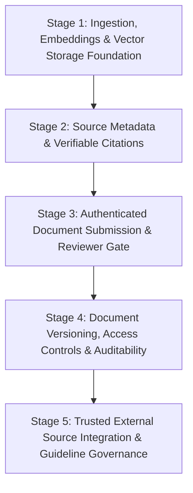

# 🧬 Requirements Specification: Extensible Source-Grounded Medical Evidence RAG System

**Specification Name**: NeuroMed AI — Wilson's Disease Source-Grounded Medical Evidence RAG System
**Document Path**: `specs/rag-enhancement/requirements.md`
**Phase**: Phase 2 — Spec-Driven Development (SDD) Requirements Specification
**Status**: Draft for User Review & Baseline Approval
**Date**: October 10, 2026
**Target Milestone**: v3.0.0-medical-rag

---

## 1. Executive Summary & Objective

The objective of this specification is to define the functional, operational, and clinical-safety requirements for transforming the prototype Retrieval-Augmented Generation (RAG) assistant in **NeuroMed AI** into an enterprise-grade, source-grounded medical evidence engine.

The system is focused on **Wilson Disease** (hepatolenticular degeneration) and designed with an extensible architecture that enables:
1. Grounding all clinical recommendations and conversational responses in verifiable, authoritative medical guidelines (AASLD, EASL, INASL, WHO) and peer-reviewed literature.
2. Enabling authorized clinicians and researchers to contribute new evidence documents through a controlled, auditable, and reviewed ingestion lifecycle.
3. Enforcing strict source citations (document title, author, year, page number, section, and DOI) while preventing hallucinated medical claims or fabricated citations.
4. Ensuring complete isolation of private, draft, or unapproved documents through role-based access control and retrieval-time security filters.

---

## 2. Baseline Architecture: Confirmed Facts vs. Assumptions vs. Unresolved Decisions

### 2.1 Repository Inspection Findings (Observed Snapshot as of October 2026 Audit)
> [!NOTE]
> The following items reflect the verified filesystem state at the time of the Phase 1 repository audit. They represent the current baseline rather than permanent runtime guarantees.

* **Document Assets**: The `medical_docs/` directory currently contains four authentic clinical guideline PDFs:
  1. `AASLD WD Guidelines.pdf` (2,079,402 bytes)
  2. `EASL-ERN Clinical Practice Guidelines on Wilson's disease.pdf` (1,645,105 bytes)
  3. `NIH Wilson Disease.pdf` (576,927 bytes)
  4. `clinical practice guidelines in WD.pdf` (3,085,536 bytes)
* **Legacy Assets**: `medical_docs_backup/` does not exist on disk (marked as deleted in the git working tree). Legacy files `wilson_disease_guidelines.txt`, `wilson_disease_question_bank.txt`, and `passages.json` are absent and superseded by the four authentic PDFs.
* **Vector Store**: `chroma_db/` is currently empty (0 bytes).
* **Environment Dependencies**: The current Python virtual environment (`Python 3.10.5`) has `pypdf 6.20.0` and `python-docx 1.2.0`, but **lacks** `chromadb`, `langchain`, `sentence-transformers`, and `torch`.
* **Runtime Fallback**: `rag_system.py` executes a standalone keyword-overlap heuristic and 400+ lines of hardcoded rule trees. ChromaDB embedding lookup and vector search are dormant at runtime.
* **Citation Mechanism**: The existing endpoint `POST /api/chat` returns a flat string `{"response": text}` with **zero citations, zero page numbers, and zero source references**.
* **Database & Governance**: The existing SQLite database (`wilson_records.db`) contains `patients`, `assessments`, `users` (roles: `admin`, `clinician`, `lab_staff`), and `audit_logs`. It has **no tables for document metadata, review status, or ingestion tracking**.
* **Current Code Limitations**: `build_vectorstore.py` currently filters exclusively for `.txt` and `.md` (skipping all `.pdf` files). `rag_system.py` fails to locate the hardcoded `.txt` files, loading zero passages at runtime.
* **Upload Limitation**: The existing `/api/upload_lab_file` route is strictly designed for patient lab values (23 numerical features); there is no route for uploading medical literature.

### 2.2 Working Assumptions
* **Local Ingestion First**: Ingestion, document parsing, embedding generation, and vector retrieval must run locally without requiring paid cloud API keys for basic functionality.
* **Initial Embeddings**: The `sentence-transformers/all-MiniLM-L6-v2` model is the baseline embedding model specified in existing code (`build_vectorstore.py` and `rag_system.py`). Its 384-dimensional vector space is lightweight and runs efficiently on CPU.
* **Persistence Engine**: ChromaDB with local file persistence (`persist_directory="chroma_db"`) is the chosen vector database engine.
* **User Identity**: The system already has an active session-based authentication layer (`auth_middleware.py`) with cryptographic passwords and CSRF protection that can be extended for document management.

### 2.3 Unresolved Architectural Decisions (For User Review)
* **OPEN-DEC-01: Semantic Retrieval Similarity Threshold**:
  - **Decision Status**: Tentative; pending benchmark evaluation.
  - **Initial Candidate**: `0.65` (configurable via `RAG_SIMILARITY_THRESHOLD`).
  - **Specification**: The semantic retrieval similarity threshold MUST remain configurable during development and MUST NOT be treated as a clinically validated constant. The value `0.65` is an initial candidate for evaluation, not an approved production threshold.
  - **Evaluation Protocol**: Before finalizing the threshold, evaluate it against a fixed benchmark of at least 50 representative Wilson disease queries, including questions covering diagnosis, symptoms, laboratory investigations, treatment, monitoring, and queries for which the approved source corpus contains no adequate evidence. The benchmark MUST use a documented set of expected relevant passages or source references established before threshold comparison. Candidate thresholds MUST be compared using the same embedding model, source corpus, similarity function, retrieval configuration, and query set.
  - **Required Metrics**: Evaluation MUST report, at minimum: (1) Relevant-evidence recall at configured retrieval cutoff; (2) Precision or rate of retrieved passages judged irrelevant; (3) No-adequate-evidence detection and abstention behavior; (4) Citation/source correctness for retrieved evidence; (5) Results for each tested threshold and rationale for the recommended choice.
  - **Clinical Safety Invariants**: If no eligible source documents match, or if the best eligible retrieved passage fails the configured similarity-score threshold, the system MUST set `evidence_found = false` and follow the specified evidence-absence behavior. The score type, similarity or distance semantics, and comparison direction MUST be defined consistently with the selected vector-store configuration (ChromaDB cosine space: cosine distance $d \in [0, 2]$, cosine similarity $s = 1 - d$, comparison direction $s \ge \text{threshold}$). A similarity score MUST NOT be interpreted as the probability that a passage is clinically correct. Passing the threshold MUST NOT bypass document authorization, clinical approval/revocation, active-generation verification, or citation/source validation.
  - **Acceptance Criterion**: The threshold remains explicitly marked tentative until the benchmark results and the selected value's rationale are documented and approved.
* **DEC-01 (LLM Generation vs Grounded Template Synthesis)**: Should conversational answer generation strictly require a local/cloud LLM (e.g. Gemini 1.5 Flash / OpenAI / local Ollama), or should a deterministic extractive-synthesis pipeline remain active as a zero-dependency fallback?
* **DEC-02 (Citation UI Presentation)**: Should citations in `templates/result.html` appear as inline clickable footnotes `[1]`, expandable collapsible cards at the bottom of the response, or an interactive side-drawer preview with extracted excerpts?
* **DEC-03 (Researcher Account Registration)**: Should researchers be created only by system administrators (as done in `manage_users.py`), or should there be a self-service registration route with admin approval?

---

## 3. Scope Boundaries & Clinical Safety Guardrails

### 3.1 Strict Out-of-Scope Exclusions
* **ML Model Core**: The supervised Machine Learning ensemble (`svm.joblib`, `logreg_base.joblib`, `bilstm_model.keras`, `meta_model.joblib`), probability calibration (`calibrator.joblib`), SHAP explainability pipeline, and 23 clinical feature preprocessing (`preprocessor.joblib`) are **strictly excluded from modification**.
* **Patient Database**: Existing `patients` and `assessments` table schemas and patient prediction flows in `app.py` (`/submit`, `/assessment/<id>/report`) must not be broken or altered.
* **Automatic Web Scraping**: The system will **never** automatically scrape arbitrary medical websites, blogs, or forums. Only explicitly vetted and approved documents may enter the evidence index.

### 3.2 Clinical Safety Principles
* **Evidence-Grounded Boundary**: The system must never claim clinical evidence exists when none was retrieved from approved documents.
* **No Speculative Dosing**: Medication dosages (chelators, zinc salts) must only be presented within explicit guideline context with mandatory disclaimers that prescription and titration require direct specialist oversight.
* **Software Testing vs Clinical Validation**: Automated software tests (unit tests, retrieval accuracy, citation verification) validate system correctness; they do not replace formal clinical validation by qualified hepatologists or neurologists.

---

## 4. Canonical Medical Source Metadata Schema

Every document and extracted chunk must be bound to the following immutable metadata structure:

| Field Name | Type | Description | Mandatory? | Constraints & Defaults | Example |
| :--- | :--- | :--- | :--- | :--- | :--- |
| `doc_id` | String (UUID) | Unique system identifier for the parent document | Yes | Primary Key | `"doc_a1b2c3d4-e5f6-7890-abcd-1234567890ab"` |
| `filename` | String | Original filename of the uploaded/staged document | Yes | Non-empty | `"AASLD WD Guidelines.pdf"` |
| `file_path` | String | Path to stored binary in quarantine/approved storage | Yes | Non-empty | `"data/documents/quarantine/doc_...bin"` |
| `content_hash` | String (SHA-256) | Cryptographic hash of the source file bytes | Yes | Unique | `"e3b0c44298fc1c149afbf4c8996fb92427ae41e4649b934ca495991b7852b855"` |
| `file_size_bytes` | Integer | Size of document file in bytes | Yes | $> 0$ | `2079402` |
| `page_count` | Integer | Total extracted pages | Yes | $\ge 1$ | `48` |
| `extraction_quality_score` | Float | Score assessing extraction completeness (0.0 to 1.0) | Yes | Default `0.0` | `0.94` |
| `origin` | Enum | Staging source: `seed` or `user_upload` | Yes | Default `'user_upload'` | `'seed'` |
| `title` | String | Working candidate title at staging; verified title after Gate 1 | Yes | Non-empty | `"Candidate: AASLD WD Guidelines"` |
| `authors_or_org` | String | Primary authors or issuing professional organization | Optional | `NULL` until populated | `"AASLD (Schilsky, M. L., et al.)"` |
| `publication_date` | String (ISO-8601) | Date of publication or formal guideline adoption | Optional | `NULL` until populated | `"2023-01-15"` |
| `version` | String | Version or edition identifier | Yes | Default `'1.0'` | `"v2023.1"` |
| `source_url` | String | Canonical web URL of official publication | Optional | `NULL` until populated | `"https://www.aasld.org/practice-guidelines/wilson-disease"` |
| `doi_or_pmid` | String | Digital Object Identifier or PubMed ID | Optional | `NULL` until populated | `"10.1002/hep.32801"` |
| `is_verified_metadata` | Integer (Boolean) | Gate 1 flag: 0 (Unverified Candidate) or 1 (Verified) | Yes | Default `0` | `0` |
| `metadata_verified_by` | String | Username of reviewer who verified metadata | Optional | Foreign Key: `users.username` | `"chief_md"` |
| `metadata_verified_at` | Timestamp | Timestamp when metadata was verified | Optional | `NULL` | `"2026-10-12T10:00:00Z"` |
| `verification_notes` | Text | Audit record of publication registry matching | Optional | `NULL` | `"Matched to PubMed PMID 36000000"` |
| `clinical_review_status` | Enum | Gate 2 flag: `pending`, `approved`, `rejected`, `revoked` | Yes | Default `'pending'` | `'pending'` |
| `reviewed_by` | String | Username of clinical reviewer | Optional | Foreign Key: `users.username` | `"chief_md"` |
| `reviewed_at` | Timestamp | Timestamp when clinical decision was made | Optional | `NULL` | `"2026-10-12T10:15:00Z"` |
| `rejection_reason` | Text | Mandatory justification if rejected or revoked | Optional | `NULL` | `"Superseded by 2024 EASL guidelines"` |
| `ingestion_status` | Enum | Cross-system status: `not_started`, `indexing`, `indexed`, `cleanup_pending`, `failed`, `purged`, `reconciliation_required` | Yes | Default `'not_started'` | `'not_started'` |
| `chunk_count` | Integer | Total verified chunks indexed in ChromaDB | Yes | Default `0` | `112` |
| `ingestion_job_id` | String | Unique tracking ID and ownership token for the active vectorization or permanent deletion operation | Optional | `NULL` | `"job_77a1b2c3"` |
| `ingestion_error` | Text | Diagnostic message if vectorization or cleanup failed | Optional | `NULL` | `NULL` |
| `last_ingested_at` | Timestamp | Timestamp of last successful vectorization | Optional | `NULL` | `NULL` |
| `access_tier` | Enum | Access control tier: `public_clinical`, `internal_research`, `private_draft` | Yes | Default `'public_clinical'` | `'public_clinical'` |
| `uploaded_by` | String | Username of contributing user (FK to `users.username`) | Optional | Mandatory if `origin = 'user_upload'`; `NULL` if `origin = 'seed'` | `"dr_smith"` |
| `uploaded_at` | Timestamp | Timestamp when file was uploaded or staged | Yes | Default `CURRENT_TIMESTAMP` | `"2026-10-12T09:30:00Z"` |

### 4.1 Schema Rules & Seed Audit Invariants
1. **Candidate Working Titles at Staging**: At document upload or seed staging, `title` is populated with a provisional working title derived from the file header or filename. The flag `is_verified_metadata = 0` explicitly marks that publication metadata is unverified candidate data. It remains unverified until Gate 1 (Metadata Verification) is completed against official publication records.
2. **Foreign Key Integrity for Seed Documents**: For baseline seed documents, `origin = 'seed'` and `uploaded_by = NULL`. This satisfies `FOREIGN KEY (uploaded_by) REFERENCES users(username)` without creating synthetic or dummy user accounts in `users`.
3. **Auditable System Staging**: The baseline seed command records an audit event in `audit_logs` with `action = 'BASELINE_SEED_STAGED'`, `user_id = NULL`, `username = 'SYSTEM'`, and `details = 'Staged 4 initial guideline PDFs from medical_docs/'`.

---

## 5. Functional Requirements by Implementation Stage



---

### STAGE 1: Document Ingestion, Embeddings, Persistent Storage & Retrieval Foundation

#### `REQ-STG1-01`: Baseline PDF Seed Registration & Quarantine Staging
* **Description**: The system shall register the four baseline Wilson Disease guideline PDFs from `medical_docs/` via an explicit, repeatable staging command (`seed_initial_documents` / `build_vectorstore.py --stage-seed`).
* **Priority**: Must-Have
* **Acceptance Criteria**:
  1. The baseline seed command opens the four PDFs in `medical_docs/` in read-only binary mode and copies them to `data/documents/quarantine/{doc_id}.pdf`. Original source files in `medical_docs/` are **never deleted, renamed, overwritten, or modified**.
  2. The system computes SHA-256 content hashes for each PDF and checks against `medical_documents` to prevent duplicate staging.
  3. Staged seed documents are registered in SQLite with `origin = 'seed'`, `uploaded_by = NULL`, `is_verified_metadata = 0`, `clinical_review_status = 'pending'`, and `ingestion_status = 'not_started'`.
  4. The staging command records an immutable audit event in `audit_logs` with `action = 'BASELINE_SEED_STAGED'`, `user_id = NULL`, `username = 'SYSTEM'`, and `details = 'Staged 4 initial guideline PDFs from medical_docs/'`.
  5. **Zero Vector Guarantee**: Zero embeddings are generated and zero records are written to ChromaDB during staging. Vectorization is strictly blocked until explicit clinical approval.
* **Dependencies**: None.
* **Relevant Files**: [`medical_docs/`](file:///c:/Users/LENOVO/OneDrive/Desktop/Wilson-Disease-Project-main/Wilson-Disease-Project-main/medical_docs), [`build_vectorstore.py`](file:///c:/Users/LENOVO/OneDrive/Desktop/Wilson-Disease-Project-main/Wilson-Disease-Project-main/Wilson-Disease-Project-main/build_vectorstore.py), [`database.py`](file:///c:/Users/LENOVO/OneDrive/Desktop/Wilson-Disease-Project-main/Wilson-Disease-Project-main/Wilson-Disease-Project-main/database.py).

#### `REQ-STG1-02`: Multi-Format Text Extraction
* **Description**: The system shall parse and extract text from plain text (`.txt`), Markdown (`.md`), Adobe PDF (`.pdf`), and Microsoft Word (`.docx`) medical documents.
* **Priority**: Must-Have
* **Acceptance Criteria**:
  1. PDF text extraction preserves original page numbers for every extracted text block using `pypdf`.
  2. DOCX text extraction identifies and preserves heading hierarchies (Heading 1, Heading 2, Body) using `python-docx`.
  3. Plain text and Markdown files are parsed with structural section identification.
  4. Non-UTF-8 encodings are safely decoded with fallback detection (`latin-1`, `cp1252`).
* **Dependencies**: `pypdf>=5.0.0`, `python-docx>=1.1.0`.
* **Relevant Files**: [`build_vectorstore.py`](file:///c:/Users/LENOVO/OneDrive/Desktop/Wilson-Disease-Project-main/Wilson-Disease-Project-main/Wilson-Disease-Project-main/build_vectorstore.py), [`lab_import.py`](file:///c:/Users/LENOVO/OneDrive/Desktop/Wilson-Disease-Project-main/Wilson-Disease-Project-main/Wilson-Disease-Project-main/lab_import.py).

#### `REQ-STG1-02B`: PDF Extraction Quality Validation
* **Description**: The ingestion pipeline shall execute automated extraction quality validation for all four baseline guideline PDFs prior to review.
* **Priority**: Must-Have
* **Acceptance Criteria**:
  1. Page character density and word counts are measured, flagging blank or scanned pages (`is_scanned_page = True`).
  2. Two-column layout flow sanity checks verify that text columns are not interwoven into unreadable streams.
  3. Essential medical keyword presence is verified across extracted text (e.g., *ceruloplasmin*, *ATP7B*, *urinary copper*, *Kayser-Fleischer*, *Leipzig score*).
  4. Tabular data parsing fidelity is evaluated for diagnostic scoring tables.
  5. An overall `extraction_quality_score` (0.0 to 1.0) is recorded in SQLite for reviewer inspection.
* **Dependencies**: `REQ-STG1-02`.
* **Relevant Files**: [`build_vectorstore.py`](file:///c:/Users/LENOVO/OneDrive/Desktop/Wilson-Disease-Project-main/Wilson-Disease-Project-main/Wilson-Disease-Project-main/build_vectorstore.py).

#### `REQ-STG1-03`: Malformed & Unreadable File Safety
* **Description**: The ingestion pipeline shall safely handle empty, corrupted, encrypted, password-protected, or unsupported files without terminating the ingestion batch or crashing the server.
* **Priority**: Must-Have
* **Acceptance Criteria**:
  1. Zero-byte files are logged and skipped with an informative diagnostic error.
  2. Password-protected or corrupt PDFs raise a handled `DocumentParsingError` and do not crash the pipeline.
  3. Binary files masquerading as text/PDF are rejected upon MIME-type inspection.
  4. Ingestion batch returns a structured report summarizing successes, warnings, and failures.
* **Dependencies**: None.
* **Relevant Files**: [`build_vectorstore.py`](file:///c:/Users/LENOVO/OneDrive/Desktop/Wilson-Disease-Project-main/Wilson-Disease-Project-main/Wilson-Disease-Project-main/build_vectorstore.py).

#### `REQ-STG1-04`: Semantic Hierarchy-Aware Chunking
* **Description**: The chunker shall divide documents into cohesive semantic segments while preserving page numbers and section context.
* **Priority**: Must-Have
* **Acceptance Criteria**:
  1. Default chunk target size is configurable (target 600–1000 characters or 150–250 tokens) with 15% overlap.
  2. Chunks do not split sentences mid-way; boundaries respect sentence punctuation (`.`, `?`, `!`) and paragraph breaks.
  3. Every chunk inherits the parent document's `page_number`, `section_heading`, `doc_id`, and active `ingestion_job_id`. Chunk IDs are deterministically formatted incorporating the job ID: `f"{doc_id}_{ingestion_job_id}_p{page_number}_c{chunk_index:04d}"`. Every chunk carries its `ingestion_job_id` in metadata.
* **Dependencies**: `REQ-STG1-02`.
* **Relevant Files**: [`build_vectorstore.py`](file:///c:/Users/LENOVO/OneDrive/Desktop/Wilson-Disease-Project-main/Wilson-Disease-Project-main/Wilson-Disease-Project-main/build_vectorstore.py).

#### `REQ-STG1-05`: Embedding Model Specification & Evaluation
* **Description**: The embedding pipeline shall utilize `sentence-transformers/all-MiniLM-L6-v2` as the baseline dense embedding engine, with benchmarking against medical domain requirements.
* **Priority**: Must-Have
* **Acceptance Criteria**:
  1. The model produces normalized 384-dimensional dense float vectors for all input chunks.
  2. Embeddings are generated deterministically: identical text produces identical vector representations ($L_2$ distance $< 10^{-6}$).
  3. CPU inference generates embeddings at a rate of $\ge 50\text{ chunks/sec}$ on standard multi-core hardware.
  4. Graceful offline execution: model weights are cached locally and require no internet access during inference.
* **Dependencies**: `sentence-transformers`, `torch`.
* **Relevant Files**: [`build_vectorstore.py`](file:///c:/Users/LENOVO/OneDrive/Desktop/Wilson-Disease-Project-main/Wilson-Disease-Project-main/Wilson-Disease-Project-main/build_vectorstore.py), [`rag_system.py`](file:///c:/Users/LENOVO/OneDrive/Desktop/Wilson-Disease-Project-main/Wilson-Disease-Project-main/Wilson-Disease-Project-main/rag_system.py).

#### `REQ-STG1-06`: Persistent ChromaDB Storage Configuration
* **Description**: ChromaDB shall be initialized with local disk persistence, managing vector indices and chunk metadata across server restarts.
* **Priority**: Must-Have
* **Acceptance Criteria**:
  1. Persistent storage directory is configured at `chroma_db/`.
  2. Collection name is standardized as `"wilson_clinical_evidence"`.
  3. Distance metric is explicitly set to cosine similarity (`"hnsw:space": "cosine"`).
  4. Data persists across process restarts without data loss or corruption.
* **Dependencies**: `chromadb>=0.4.0`.
* **Relevant Files**: [`build_vectorstore.py`](file:///c:/Users/LENOVO/OneDrive/Desktop/Wilson-Disease-Project-main/Wilson-Disease-Project-main/Wilson-Disease-Project-main/build_vectorstore.py), [`rag_system.py`](file:///c:/Users/LENOVO/OneDrive/Desktop/Wilson-Disease-Project-main/Wilson-Disease-Project-main/Wilson-Disease-Project-main/rag_system.py).

#### `REQ-STG1-07`: Recoverable Cross-System Ingestion, Duplicate Consistency & Approval Invariants
* **Description**: Ingestion shall enforce two-gate approval invariants, comprehensive duplicate rejection across all lifecycle states, and recoverable cross-system vector synchronization.
* **Priority**: Must-Have
* **Acceptance Criteria**:
  1. **Gate 1 & Gate 2 Invariant**: A document cannot transition to `clinical_review_status = 'approved'` unless `is_verified_metadata = 1`. Any clinical approval attempt on unverified metadata is rejected with `HTTP 400 Bad Request` (*"Metadata must be verified against official publication records before clinical approval"*).
  2. **Retrieval Preconditions**: Evidence passages are retrievable if and only if all five conditions are met in SQLite and verified at Layer 2:
     - `is_verified_metadata = 1`
     - `clinical_review_status = 'approved'`
     - `ingestion_status = 'indexed'`
     - `access_tier = 'public_clinical'` (or accessible according to the requesting role's tier)
     - **Authoritative Generation Matching**: The candidate chunk's `ingestion_job_id` carried in metadata matches the current indexed generation (`ingestion_job_id`) recorded in the authoritative SQLite `medical_documents` row. Candidate chunks with mismatched or missing generation IDs are rejected immediately.
     Only verified, approved, indexed documents belonging to the active generation accessible to the requesting role can be used as evidence. Any chunk failing any condition is dropped prior to answer synthesis.
  3. **Deterministic Duplicate Rejection (SHA-256)**:
     - **Canonical Active/Queued**: If matching record is `pending` + `not_started`, reject upload (`HTTP 409 Conflict`) indicating review is already queued. If `approved` + `indexed`, reject upload (`HTTP 409 Conflict`) indicating document is already active in retrieval. If `approved` + `not_started`, reject upload (`HTTP 409 Conflict`) indicating document is approved and awaiting indexing.
     - **Canonical Historical**: If matching record is `rejected` + `not_started`, reject upload (`HTTP 409 Conflict`) citing prior rejection date/reason; direct re-upload is blocked, requiring `POST /api/documents/<id>/reopen-review`. If `revoked` + `purged`, reject upload (`HTTP 409 Conflict`) citing revocation date/reason; reinstatement requires `POST /api/documents/<id>/reopen-review`.
     - **Intermediate In-Flight**: If matching record is undergoing active processing (`approved` + `indexing`, or `cleanup_pending`), reject upload (`HTTP 409 Conflict`) indicating vector operations are in progress.
     - **Recoverable Failures & Maintenance**: If matching record is `approved` + `failed`, reject upload (`HTTP 409 Conflict`) directing administrator to trigger idempotent retry (`POST /api/documents/<id>/retry-indexing`). If `reconciliation_required`, reject upload (`HTTP 409 Conflict`) directing administrator to execute reconciliation (`--reconcile`). If `approved` + `purged`, reject upload (`HTTP 409 Conflict`) directing administrator to re-index the existing approved record.
     - **Invalid Invariant Violations**: If matching record represents an invalid combination (e.g. `pending` or `rejected` with `indexed`), reject upload (`HTTP 409 Conflict`), log a critical security audit event, and require administrative inspection rather than silent overwriting.
  4. **Controlled Reconsideration Workflow**: Reconsidering a rejected or revoked document requires an explicit, audited administrative action (`POST /api/documents/<doc_id>/reopen-review` with mandatory `reopen_justification` logged to `audit_logs`). Re-uploading identical bytes directly is blocked. Reopening resets `clinical_review_status = 'pending'`, `is_verified_metadata = 0`, and `ingestion_status = 'not_started'`, requiring the document to pass both Gate 1 and Gate 2 from scratch. Reopening must not restore retrieval until the document has successfully passed all verification and clinical review gates and vector indexing has succeeded.
  5. **Idempotent Revocation Coordination, Purge Verification & Access-Tier Decoupling**:
     - **Access-Tier Decoupling Invariant**: Changing a document's access tier (`POST /api/documents/<doc_id>/access-tier`) and revoking clinical approval (`POST /api/documents/<doc_id>/revoke`) are strictly separate operations. Modifying `access_tier` to non-public (e.g. `internal_research` or `private_draft`) immediately excludes the document from standard clinical consultation queries at Layer 2 (which enforces `access_tier = 'public_clinical'`), but preserves its medical approval (`clinical_review_status` remains `'approved'`) and does not trigger vector purging. Clinical revocation is strictly reserved for formal medical invalidation.
     - **Guarded State Transition & Immediate Exclusion**: Initiating revocation on a document not yet revoked executes an atomic guarded SQLite transition:
       ```sql
       UPDATE medical_documents
       SET clinical_review_status = 'revoked',
           ingestion_status = 'cleanup_pending',
           reviewed_by = :admin_user,
           reviewed_at = CURRENT_TIMESTAMP,
           rejection_reason = :revocation_reason
       WHERE doc_id = :doc_id
         AND clinical_review_status != 'revoked'
         AND clinical_review_status != 'rejected';
       ```
       If `clinical_review_status == 'rejected'`, the request is rejected with `HTTP 400 Bad Request` (*"Cannot revoke document with clinical_review_status 'rejected'; rejection is already a non-approved terminal state"*). Layer 2 relational verification immediately drops the document from clinical retrieval; authoritative SQLite status and access permissions are validated on every query, and vector presence in ChromaDB must never override SQLite revocation.
     - **Idempotent Revocation & Unfinished Cleanup Resumption**: Repeated revocation requests on an already revoked document (`clinical_review_status = 'revoked'`) must be idempotent. If `ingestion_status = 'purged'`, the request returns `HTTP 200 OK` (no-op). If cleanup is actively executing in a live worker, it returns `HTTP 409 Conflict`. If previous cleanup was interrupted or failed (`cleanup_pending` without an active worker, or `reconciliation_required`), repeated revocation safely resumes unfinished cleanup via an atomic guarded transition (`UPDATE medical_documents SET ingestion_status = 'cleanup_pending', ingestion_error = NULL WHERE doc_id = :doc_id AND clinical_review_status = 'revoked' AND ingestion_status IN ('reconciliation_required', 'cleanup_pending');`) rather than stranding the document or overwriting an active operation.
     - **Worker Coordination Contract**: Revocation coordinates with any active indexing job so that cleanup cannot declare completion while an indexing worker may still write vectors. A cancellation request alone is insufficient; the revocation workflow must affirmatively establish that the indexing worker has terminated or otherwise cannot perform further writes (worker-write exclusion established) before proceeding to vector deletion.
     - **Definitive Document-Scoped Vector Purge & Post-Deletion Verification Gate**: Only after worker-write exclusion is established, the revocation workflow executes document-scoped ChromaDB deletion (`collection.delete(where={"doc_id": doc_id})`). Following deletion, the system MUST verify vector absence by querying ChromaDB (`collection.get(where={"doc_id": doc_id}, limit=1)`). The document is marked `ingestion_status = 'purged'` if and only if worker-write exclusion has been verified AND post-deletion verification confirms that zero chunks remain for `doc_id`.
     - **Reconciliation Fallback**: If ChromaDB is unavailable, if worker termination/write exclusion cannot be confirmed, if vector deletion fails, or if post-deletion verification reveals residual chunks or fails, the document MUST NOT be marked `purged`. It retains a non-retrievable state, transitions to or retains `ingestion_status = 'reconciliation_required'` with diagnostic details logged in `ingestion_error`, and emits a security audit event (`REVOCATION_CLEANUP_FAILED`, `VECTOR_PURGE_VERIFICATION_FAILED`, or `VECTOR_STORE_UNAVAILABLE`).
     - **Durable Crash Recovery**: If the system crashes during cleanup (e.g. while in `cleanup_pending`), recovery resumes safely from durable SQLite state on startup or reconciliation. Do not assume SQLite, ChromaDB, and the worker share an atomic transaction; startup reconciliation detects uncompleted `cleanup_pending` records, establishes worker-write exclusion, re-executes the purge, and verifies purge completion.
     - **Implementation-Agnostic Safety Contract**: The required safety behavior is enforced without assuming a specific lock, queue, or cancellation library implementation that has not yet been selected.
  6. **Retry Eligibility, Guarded Worker Updates, Per-Document Fencing & Stale Worker Exclusion**:
     - **Eligibility Preconditions**: Only an approved document (`clinical_review_status = 'approved'`) in an eligible failure or recovery state (`ingestion_status IN ('failed', 'reconciliation_required')`) may initiate a retry (`POST /api/documents/<doc_id>/retry-indexing`). Any attempt to retry an unapproved document or a document with an active operation in-flight (`indexing` or `cleanup_pending`) is strictly rejected with `HTTP 409 Conflict`. Retry cannot bypass failed cleanup or active operations.
     - **Guarded Atomic Claim Transition**: The retry operation must claim the document via a guarded atomic SQLite transition:
       ```sql
       UPDATE medical_documents
       SET ingestion_status = 'indexing',
           ingestion_job_id = :new_job_id,
           ingestion_error = NULL
       WHERE doc_id = :doc_id
         AND clinical_review_status = 'approved'
         AND ingestion_status IN ('failed', 'reconciliation_required');
       ```
       Concurrent retry attempts must have exactly one winner (the transition affecting 1 row). Losing attempts affect 0 rows, receive `HTTP 409 Conflict`, and must not alter the winner's job ID or state.
     - **Per-Document Serialization Lease & ChromaDB Generation Fencing**: A SQLite job-ID check alone does not fence ChromaDB operations. To prevent a delayed stale worker from overwriting or deleting vectors written by a newer job:
       - Only one active worker may hold the execution lease for a given `doc_id`.
       - Chunk IDs are deterministically formatted incorporating the job ID: `f"{doc_id}_{ingestion_job_id}_p{page_number}_c{chunk_index:04d}"`. This guarantees that vectors written by different ingestion jobs occupy disjoint ID spaces in ChromaDB, preventing cross-generation chunk overwrites.
       - Every vector chunk written to ChromaDB MUST include the active `ingestion_job_id` in chunk metadata (`metadata.ingestion_job_id = :job_id`).
       - Before writing any batch of embeddings to ChromaDB, a worker must re-verify that its lease remains valid in SQLite (`SELECT 1 FROM medical_documents WHERE doc_id = :doc_id AND ingestion_job_id = :my_job_id AND ingestion_status = 'indexing' AND clinical_review_status = 'approved'`). If its lease has been revoked or superseded, the worker must terminate immediately without writing to ChromaDB.
       - A stale worker's compensating cleanup MUST be strictly fenced to its own job ID: `collection.delete(where={"$and": [{"doc_id": doc_id}, {"ingestion_job_id": my_job_id}]})`. A stale worker must NEVER execute an unfenced document-wide deletion, ensuring it can never delete another job's vectors.
     - **Mandatory Pre-Embedding Sweep Deletion**: Before computing embeddings or writing any new vectors, the newly authorized retry worker (holding the active claim) must execute a successful document-scoped ChromaDB sweep deletion (`collection.delete(where={"doc_id": doc_id})`) and verify vector absence (`collection.get(where={"doc_id": doc_id}, limit=1)` returning 0 chunks). If sweep deletion or verification fails, the worker must abort re-indexing immediately without computing embeddings or writing vectors, transition SQLite to `ingestion_status = 'reconciliation_required'`, record a diagnostic `ingestion_error`, and emit an audit event (`RETRY_SWEEP_PURGE_FAILED`). Returning an HTTP error code alone does not provide safety; the durable recovery state must be recorded.
     - **Guarded Worker State Updates (Success, Failure & Cleanup)**: EVERY state transition attempted by a worker must conditionally verify that the worker still holds ownership:
       - *Success Completion*:
         ```sql
         UPDATE medical_documents
         SET ingestion_status = 'indexed',
             chunk_count = :chunk_count,
             last_ingested_at = CURRENT_TIMESTAMP,
             ingestion_error = NULL
         WHERE doc_id = :doc_id
           AND clinical_review_status = 'approved'
           AND ingestion_status = 'indexing'
           AND ingestion_job_id = :current_job_id;
         ```
       - *Failure Stage 1 (Claim Cleanup Pending)*: If an exception occurs during extraction, embedding computation, or vector upsert, the worker executes a guarded transition checking its job ID:
         ```sql
         UPDATE medical_documents
         SET ingestion_status = 'cleanup_pending',
             ingestion_error = :error_msg
         WHERE doc_id = :doc_id
           AND clinical_review_status = 'approved'
           AND ingestion_status = 'indexing'
           AND ingestion_job_id = :current_job_id;
         ```
         If 0 rows are updated, the worker has lost ownership and aborts immediately without modifying state.
       - *Job-Scoped Compensating Vector Purge & Verification Gate*: If 1 row is updated, the worker executes a compensating vector purge strictly scoped to its own job ID: `collection.delete(where={"$and": [{"doc_id": doc_id}, {"ingestion_job_id": current_job_id}]})`, followed by a post-deletion verification query `collection.get(where={"$and": [{"doc_id": doc_id}, {"ingestion_job_id": current_job_id}]}, limit=1)`.
       - *Failure Stage 2A (Cleanup Verified Succeeded)*: If compensating purge and verification succeed (0 residual chunks for `current_job_id`), the worker transitions the document to `failed`:
         ```sql
         UPDATE medical_documents
         SET ingestion_status = 'failed'
         WHERE doc_id = :doc_id
           AND clinical_review_status = 'approved'
           AND ingestion_status = 'cleanup_pending'
           AND ingestion_job_id = :current_job_id;
         ```
       - *Failure Stage 2B (Cleanup Failed, Verification Incomplete, or Vector Store Unavailable)*: If ChromaDB is unavailable, compensating purge fails, or verification detects residual chunks:
         ```sql
         UPDATE medical_documents
         SET ingestion_status = 'reconciliation_required',
             ingestion_error = :cleanup_error_msg
         WHERE doc_id = :doc_id
           AND clinical_review_status = 'approved'
           AND ingestion_status = 'cleanup_pending'
           AND ingestion_job_id = :current_job_id;
         ```
         and emits an audit event (`COMPENSATING_CLEANUP_FAILED`, `VECTOR_PURGE_VERIFICATION_FAILED`, or `VECTOR_STORE_UNAVAILABLE`). Retrieval remains 100% blocked at Layer 2.
       - *Zero-Row Invariant Across All Stages*: If ANY of these updates affects zero rows (because revocation occurred, access tier changed, or another job took ownership), the stale worker has lost ownership. The stale worker MUST NOT overwrite SQLite state, MUST NOT retry updates, and MUST abort immediately.
     - **Crash Recovery between Steps**: If the process crashes between vector writes, guarded completion, or cleanup, the durable SQLite state remains `indexing` or `cleanup_pending`, keeping Layer 2 retrieval completely blocked. Startup reconciliation detects stale jobs without active workers, marks `reconciliation_required`, and requires a verified pre-embedding sweep deletion before any subsequent retry is permitted.
     - **Remaining Limitation & Orphaned Generation Reconciliation**:
       Job-scoped chunk IDs and metadata generation tagging prevent a stale worker from overwriting active vectors and prevent stale cleanup from deleting a newer job's vectors. However, because SQLite and ChromaDB do not participate in a distributed two-phase commit transaction (a SQLite pre-write lease check does not form an atomic transaction with ChromaDB), a SQLite pre-write check alone cannot eliminate the race window: a stale worker pre-empted immediately after passing its SQLite check could still write chunks to ChromaDB before detecting its lost lease. These delayed writes form an *orphaned generation*.
       - *Retrieval Protection*: Layer 2 relational authorization strictly excludes these orphaned chunks from ever being used as evidence (candidate chunk `ingestion_job_id` must match the current indexed generation in SQLite `medical_documents`). Only verified, approved, indexed documents belonging to the active generation accessible to the requesting role can be used as evidence.
       - *Reconciliation Protocol*: To prevent storage leaks, the reconciliation protocol (`python build_vectorstore.py --reconcile` or startup routine) detects and removes orphaned generations: it inspects ChromaDB chunks for each `doc_id`, compares chunk `ingestion_job_id` against the authoritative active `ingestion_job_id` in SQLite, and issues a fenced deletion `collection.delete(where={"$and": [{"doc_id": doc_id}, {"ingestion_job_id": orphaned_job_id}]})` for any generation that is not the active indexed generation. The active indexed generation is strictly preserved.
* **Dependencies**: `REQ-STG1-05`, `REQ-STG1-06`.
* **Relevant Files**: [`build_vectorstore.py`](file:///c:/Users/LENOVO/OneDrive/Desktop/Wilson-Disease-Project-main/Wilson-Disease-Project-main/Wilson-Disease-Project-main/build_vectorstore.py), [`database.py`](file:///c:/Users/LENOVO/OneDrive/Desktop/Wilson-Disease-Project-main/Wilson-Disease-Project-main/Wilson-Disease-Project-main/database.py).

#### `REQ-STG1-08`: Dense Semantic Vector Retrieval & Similarity Threshold Configuration
* **Description**: Given a natural language medical query, the retriever shall retrieve top-$k$ relevant chunks using cosine similarity from approved and indexed evidence documents.
* **Priority**: Must-Have
* **Acceptance Criteria**:
  1. Query is embedded using the exact same embedding model (`all-MiniLM-L6-v2`).
  2. Retriever returns top-$k$ chunks (default $k=4$, configurable) with similarity scores.
  3. Chunks are filtered through the two-layer verification architecture (Layer 1 ChromaDB pre-filter and Layer 2 SQLite relational authority check).
  4. **Configurable Threshold & Semantic Vector Store Score Semantics**: The minimum similarity threshold is maintained as a configurable software setting (`RAG_SIMILARITY_THRESHOLD`). The score type, similarity or distance semantics, and comparison direction are defined consistently with the vector-store configuration: with ChromaDB configured for cosine space (`{"hnsw:space": "cosine"}`), the retriever converts raw Chroma cosine distance $d \in [0, 2]$ to cosine similarity $s = 1 - d$. A candidate chunk satisfies the threshold if and only if $s \ge \text{RAG\_SIMILARITY\_THRESHOLD}$ (comparison direction: higher similarity is better).
  5. **Tentative Status & Benchmark Evaluation (`OPEN-DEC-01`)**: The initial threshold candidate is `0.65`, explicitly tentative under OPEN-DEC-01, and MUST NOT be treated as a clinically validated constant. Final threshold selection is deferred until evaluated against a fixed benchmark of at least 50 representative Wilson disease queries covering diagnosis, symptoms, laboratory investigations, treatment, monitoring, and queries for which the approved source corpus contains no adequate evidence. Candidate thresholds MUST be compared using the same embedding model, source corpus, similarity function, retrieval configuration, and query set. Evaluation MUST report relevant-evidence recall at configured retrieval cutoff, precision or irrelevant passage rate, no-adequate-evidence detection and abstention behavior, citation/source correctness, and tested threshold trade-offs.
  6. **Evidence Absence & Non-Bypass Safety Invariants**: If no eligible source documents match, or if the best eligible retrieved passage fails the configured similarity threshold ($s < \text{RAG\_SIMILARITY\_THRESHOLD}$), the system MUST set `evidence_found = false` and route to evidence-absence fallback. A similarity score MUST NOT be interpreted as the probability that a passage is clinically correct. Passing the similarity threshold MUST NOT bypass document authorization, clinical approval/revocation checks, active-generation verification, or citation/source validation.
  7. Retrieval latency is $< 100\text{ ms}$ for collections under 10,000 chunks.
* **Dependencies**: `REQ-STG1-06`, `REQ-STG1-07`.
* **Relevant Files**: [`rag_system.py`](file:///c:/Users/LENOVO/OneDrive/Desktop/Wilson-Disease-Project-main/Wilson-Disease-Project-main/Wilson-Disease-Project-main/rag_system.py).

---

### STAGE 2: Source Metadata & Verifiable Citations

#### `REQ-STG2-01`: Chunk-Level Metadata Propagation & Authoritative Relational Grounding
* **Description**: Every retrieved chunk returned by the vector store must carry parent document identifiers, with displayed bibliographic citation fields resolved authoritatively from SQLite.
* **Priority**: Must-Have
* **Acceptance Criteria**:
  1. The retrieval payload includes `chunk_id`, `doc_id`, `ingestion_job_id`, `page_number`, `section_heading`, and excerpted chunk text.
  2. No chunk is returned without an identifiable `doc_id`.
  3. **Authoritative Relational Metadata Grounding**: All displayed bibliographic citation fields (`title`, `authors_or_org`, `publication_date`, `publication_year`, `doi_or_pmid`, `source_url`, `version`) shall be loaded directly from the authoritative SQLite `medical_documents` record after passing retrieval authorization checks, and must never rely on ChromaDB metadata as ground truth. If the corresponding SQLite record is missing, unverified (`is_verified_metadata = 0`), revoked, inaccessible for the user's access tier, not indexed (`ingestion_status != 'indexed'`), or if the candidate chunk's `ingestion_job_id` fails to match the active indexed generation recorded in the authoritative SQLite row (mismatched or missing generation ID), the chunk shall be dropped and zero citations emitted for it. Only verified, approved, indexed documents accessible to the requesting role can be used as evidence.
* **Dependencies**: `REQ-STG1-06`, `REQ-STG1-08`.
* **Relevant Files**: [`rag_system.py`](file:///c:/Users/LENOVO/OneDrive/Desktop/Wilson-Disease-Project-main/Wilson-Disease-Project-main/Wilson-Disease-Project-main/rag_system.py).

#### `REQ-STG2-02`: Source-Grounded Answer Synthesis
* **Description**: The RAG synthesis engine shall generate clinical answers strictly supported by the retrieved passages, tying claims directly to source evidence.
* **Priority**: Must-Have
* **Acceptance Criteria**:
  1. Every factual clinical claim is linked to one or more retrieved chunks.
  2. The synthesis engine distinguishes explicitly supported guideline statements from general clinical definitions.
  3. The answer incorporates numbered or tagged citation references (e.g. `[AASLD 2023, p. 14]`).
* **Dependencies**: `REQ-STG2-01`.
* **Relevant Files**: [`rag_system.py`](file:///c:/Users/LENOVO/OneDrive/Desktop/Wilson-Disease-Project-main/Wilson-Disease-Project-main/Wilson-Disease-Project-main/rag_system.py).

#### `REQ-STG2-03`: Structured Citation API Contract
* **Description**: The backend API endpoint `/api/chat` shall return a structured JSON response containing the synthesized answer and a verified list of citation objects.
* **Priority**: Must-Have
* **Acceptance Criteria**:
  1. Response JSON adheres to the contract:
     ```json
     {
       "success": true,
       "response": "Clinical answer text with citation tags [1]...",
       "citations": [
         {
           "citation_index": 1,
           "doc_id": "doc_guidelines_aasld_2023",
           "title": "AASLD Practice Guidance on Wilson Disease",
           "authors": "Schilsky, M. L., et al.",
           "publication_year": 2023,
           "page_number": 14,
           "section": "Diagnostic Criteria",
           "doi": "10.1002/hep.32801",
           "source_url": "https://www.aasld.org/...",
           "quoted_text": "Serum ceruloplasmin below 10 mg/dL strongly supports..."
         }
       ],
       "confidence_score": 0.89,
       "evidence_found": true
     }
     ```
  2. Citations contain actual extracted excerpts (`quoted_text`), not synthesized or modified text.
  3. Displayed citation fields (`title`, `authors`, `publication_year`, `doi`, `source_url`) are populated strictly from the verified SQLite `medical_documents` ground-truth row, not ChromaDB metadata. If a document fails Layer 2 relational verification, its chunks are dropped and no citation is emitted.
* **Dependencies**: `REQ-STG2-02`.
* **Relevant Files**: [`app.py`](file:///c:/Users/LENOVO/OneDrive/Desktop/Wilson-Disease-Project-main/Wilson-Disease-Project-main/Wilson-Disease-Project-main/app.py#L1137-L1152), [`rag_system.py`](file:///c:/Users/LENOVO/OneDrive/Desktop/Wilson-Disease-Project-main/Wilson-Disease-Project-main/Wilson-Disease-Project-main/rag_system.py).

#### `REQ-STG2-04`: Interactive Citation UI Rendering
* **Description**: The frontend clinical chatbot interface in `templates/result.html` shall render interactive citation badges and expandable evidence cards.
* **Priority**: Should-Have
* **Acceptance Criteria**:
  1. Inline citation badges `[1]`, `[2]` appear in the assistant chat bubble.
  2. Clicking or hovering on a citation badge highlights the corresponding source card or opens a modal preview showing Document Title, Page, Section, DOI, and the exact supporting passage.
  3. External DOI/URL links open safely in a new browser tab (`target="_blank" rel="noopener noreferrer"`).
* **Dependencies**: `REQ-STG2-03`.
* **Relevant Files**: [`templates/result.html`](file:///c:/Users/LENOVO/OneDrive/Desktop/Wilson-Disease-Project-main/Wilson-Disease-Project-main/Wilson-Disease-Project-main/templates/result.html).

#### `REQ-STG2-05`: Evidence Absence Fallback & Hallucination Prevention
* **Description**: When retrieved evidence does not meet relevance thresholds, no eligible source documents match, or no chunks survive authorization and generation verification, the system shall explicitly state that no verified guideline evidence exists rather than fabricating answers or citations.
* **Priority**: Must-Have
* **Acceptance Criteria**:
  1. **Evidence-Absence Fallback and Similarity Threshold**: If no eligible source documents match, no retrieved chunks remain after Layer 2 authorization and generation verification, or the highest similarity score among eligible retrieved passages is below the configured threshold, the system MUST set `evidence_found = false` and execute the specified evidence-absence behavior.
  2. **Configurable Candidate Threshold**: The initial threshold candidate is `0.65`, explicitly tentative under `OPEN-DEC-01`, and MUST be configurable through `RAG_SIMILARITY_THRESHOLD`.
  3. **Score Conversion & Comparison Direction**: When using ChromaDB configured with cosine distance, the system MUST convert the returned distance $d$ to cosine similarity using $s = 1 - d$, and MUST accept a passage for threshold evaluation only when $s \geq \text{RAG\_SIMILARITY\_THRESHOLD}$. The implementation MUST apply the documented score conversion and comparison direction consistently with the configured vector-store metric.
  4. **Non-Bypass Clinical Safety Invariant**: Passing the similarity threshold MUST NOT bypass document authorization, clinical approval and revocation checks, active-generation verification, or citation/source validation. A similarity score MUST NOT be interpreted as the probability that a passage is clinically correct.
  5. **Evidence-Absence Response Pathway**: If no eligible passage meets the threshold, the system MUST follow the specified evidence-absence response pathway and MUST NOT generate unsupported clinical claims. The system returns an explicit fallback: `"I could not find supporting evidence for this specific question in the approved Wilson Disease clinical guidelines. Please consult a treating hepatologist."` and the `citations` array is empty `[]`.
* **Dependencies**: `REQ-STG1-08`, `REQ-STG2-03`.
* **Relevant Files**: [`rag_system.py`](file:///c:/Users/LENOVO/OneDrive/Desktop/Wilson-Disease-Project-main/Wilson-Disease-Project-main/Wilson-Disease-Project-main/rag_system.py).

#### `REQ-STG2-06`: Clinical Advice Card Source Grounding
* **Description**: The automated clinical recommendations generated upon patient assessment (`/submit` route) shall be grounded in retrieved guideline chunks with explicit source attribution.
* **Priority**: Should-Have
* **Acceptance Criteria**:
  1. `rag_assistant.get_clinical_recommendations()` includes citations for chelation guidelines, zinc therapy, and dietary copper restrictions.
  2. Recommendations rendered on the results page display the guideline basis (e.g. *Source: AASLD 2023 Guidance Sec. 6*).
* **Dependencies**: `REQ-STG2-02`.
* **Relevant Files**: [`app.py` (Line 1084)](file:///c:/Users/LENOVO/OneDrive/Desktop/Wilson-Disease-Project-main/Wilson-Disease-Project-main/Wilson-Disease-Project-main/app.py#L1084), [`templates/result.html`](file:///c:/Users/LENOVO/OneDrive/Desktop/Wilson-Disease-Project-main/Wilson-Disease-Project-main/templates/result.html).

---

### STAGE 3: Authenticated Document Submission & Reviewer Approval Gate

#### `REQ-STG3-01`: Researcher Role & RBAC Permissions
* **Description**: The system shall add a dedicated `researcher` role to the user authentication and authorization subsystem.
* **Priority**: Must-Have
* **Acceptance Criteria**:
  1. `users.role` check constraint in SQLite database supports `'admin'`, `'clinician'`, `'lab_staff'`, and `'researcher'`.
  2. `auth_middleware.py` permits `'researcher'` and `'clinician'` to access document upload and viewing endpoints.
  3. Only `'admin'` and designated Chief Clinicians possess permission to approve or reject submitted documents.
* **Dependencies**: [`database.py`](file:///c:/Users/LENOVO/OneDrive/Desktop/Wilson-Disease-Project-main/Wilson-Disease-Project-main/Wilson-Disease-Project-main/database.py#L177), [`auth_middleware.py`](file:///c:/Users/LENOVO/OneDrive/Desktop/Wilson-Disease-Project-main/Wilson-Disease-Project-main/Wilson-Disease-Project-main/auth_middleware.py).
* **Relevant Files**: `database.py`, `auth_middleware.py`, `manage_users.py`.

#### `REQ-STG3-02`: Document Ingestion Database Schema
* **Description**: The database shall maintain persistent relational records for uploaded medical documents and their review status.
* **Priority**: Must-Have
* **Acceptance Criteria**:
  1. A `medical_documents` table is created in `wilson_records.db`:
     ```sql
     CREATE TABLE IF NOT EXISTS medical_documents (
         doc_id TEXT PRIMARY KEY,
         filename TEXT NOT NULL,
         file_path TEXT NOT NULL,
         content_hash TEXT UNIQUE NOT NULL,
         file_size_bytes INTEGER NOT NULL,
         page_count INTEGER NOT NULL,
         extraction_quality_score REAL DEFAULT 0.0,
         origin TEXT NOT NULL CHECK(origin IN ('seed', 'user_upload')) DEFAULT 'user_upload',
         title TEXT NOT NULL,
         authors_or_org TEXT,
         publication_date TEXT,
         version TEXT DEFAULT '1.0',
         source_url TEXT,
         doi_or_pmid TEXT,
         is_verified_metadata INTEGER NOT NULL DEFAULT 0,
         metadata_verified_by TEXT,
         metadata_verified_at TIMESTAMP,
         verification_notes TEXT,
         clinical_review_status TEXT NOT NULL CHECK(clinical_review_status IN ('pending', 'approved', 'rejected', 'revoked')) DEFAULT 'pending',
         reviewed_by TEXT,
         reviewed_at TIMESTAMP,
         rejection_reason TEXT,
         ingestion_status TEXT NOT NULL CHECK(ingestion_status IN ('not_started', 'indexing', 'indexed', 'cleanup_pending', 'failed', 'purged', 'reconciliation_required')) DEFAULT 'not_started',
         chunk_count INTEGER DEFAULT 0,
         ingestion_job_id TEXT,
         ingestion_error TEXT,
         last_ingested_at TIMESTAMP,
         access_tier TEXT NOT NULL CHECK(access_tier IN ('public_clinical', 'internal_research', 'private_draft')) DEFAULT 'public_clinical',
         uploaded_by TEXT,
         uploaded_at TIMESTAMP DEFAULT CURRENT_TIMESTAMP,
         FOREIGN KEY (uploaded_by) REFERENCES users(username),
         FOREIGN KEY (metadata_verified_by) REFERENCES users(username),
         FOREIGN KEY (reviewed_by) REFERENCES users(username),
         CHECK ((origin = 'seed' AND uploaded_by IS NULL) OR (origin = 'user_upload' AND uploaded_by IS NOT NULL))
     );
     ```
  2. Indexes are established on `content_hash`, `clinical_review_status`, `ingestion_status`, and `uploaded_by`.
* **Dependencies**: `REQ-STG3-01`.
* **Relevant Files**: [`database.py`](file:///c:/Users/LENOVO/OneDrive/Desktop/Wilson-Disease-Project-main/Wilson-Disease-Project-main/Wilson-Disease-Project-main/database.py).

#### `REQ-STG3-03`: Authorized Document Upload Portal
* **Description**: Authorized doctors and researchers shall have a web interface and REST API to submit new medical documents with mandatory metadata.
* **Priority**: Must-Have
* **Acceptance Criteria**:
  1. Endpoint `POST /api/documents/upload` requires authentication (`@roles_required('clinician', 'researcher', 'admin')`).
  2. Upload form enforces mandatory metadata: Document Title, Authors/Organization, Publication Date, Document Type (`Guideline`, `Clinical Trial`, `Review`, `Case Report`), and optional DOI/PMID/URL.
  3. Uploaded file is stored securely in a quarantined storage folder (`data/documents/quarantine/`), outside web root.
  4. File upload size limit is enforced (default 25 MB max).
  5. Initial `clinical_review_status` is automatically set to `'pending'`, `is_verified_metadata` is set to `0`, and `ingestion_status` is set to `'not_started'`.
* **Dependencies**: `REQ-STG3-02`.
* **Relevant Files**: `app.py`, new template `templates/document_upload.html`.

#### `REQ-STG3-04`: Ingestion Duplicate Pre-Check
* **Description**: When a user submits a document, the system shall compute its SHA-256 content hash and verify whether an identical document already exists in the repository.
* **Priority**: Must-Have
* **Acceptance Criteria**:
  1. If the content hash matches an existing record, the upload is rejected with HTTP 409 Conflict.
  2. The user is informed of the existing document ID, title, and current `clinical_review_status`.
  3. Duplicate file is not written to disk.
* **Dependencies**: `REQ-STG3-03`.
* **Relevant Files**: `app.py`, `database.py`.

#### `REQ-STG3-05`: Clinical Review & Approval Queue
* **Description**: Authorized reviewers (Admins/Chief Clinicians) shall have a review dashboard to inspect submitted documents, examine extracted text, and approve or reject submissions.
* **Priority**: Must-Have
* **Acceptance Criteria**:
  1. Endpoint `GET /documents/review-queue` lists all documents with `clinical_review_status = 'pending'`.
  2. Reviewer can view document metadata, download the source file, and preview parsed chunks.
  3. Reviewer can verify metadata against authoritative registries (`POST /api/documents/<doc_id>/verify-metadata`), setting `is_verified_metadata = 1` (Gate 1).
  4. Reviewer can submit an approval (`POST /api/documents/<doc_id>/approve`), which strictly requires `is_verified_metadata == 1` (Gate 2).
  5. Reviewer can submit a rejection (`POST /api/documents/<doc_id>/reject`) with mandatory reviewer notes/reasons.
* **Dependencies**: `REQ-STG3-02`.
* **Relevant Files**: `app.py`, new template `templates/document_review.html`.

#### `REQ-STG3-06`: Strict Vectorization Boundary
* **Description**: Under no circumstances shall an unapproved, pending, or rejected document be converted into embeddings or added to the active ChromaDB vector index.
* **Priority**: Must-Have
* **Acceptance Criteria**:
  1. ChromaDB indexing is triggered **only upon successful execution of document approval** (`clinical_review_status = 'approved'` and `is_verified_metadata = 1`).
  2. The vectorization worker verifies `clinical_review_status == 'approved'` before generating embeddings, and tracks progress via `ingestion_status = 'indexing'`.
  3. Rejected documents remain strictly archived in quarantined storage with 0 vectors in ChromaDB.
  4. The approval vectorization worker operates under the per-document serialization lease, job-scoped deterministic chunk IDs (`f"{doc_id}_{ingestion_job_id}_p{page_number}_c{chunk_index:04d}"`), ChromaDB generation fencing (`metadata.ingestion_job_id = job_id`), pre-write lease re-verification, guarded success/failure transitions, and job-scoped compensating cleanup specified in `REQ-STG1-07`.
* **Dependencies**: `REQ-STG1-06`, `REQ-STG3-05`.
* **Relevant Files**: `rag_system.py`, `database.py`.

---

### STAGE 4: Document Versioning, Access Controls & Auditability

#### `REQ-STG4-01`: Retrieval-Time Access Pre-Filtering
* **Description**: The semantic retriever shall apply metadata pre-filtering so that users only retrieve chunks matching their role and authorized access tier.
* **Priority**: Must-Have
* **Acceptance Criteria**:
  1. Standard clinicians retrieve chunks with `access_tier = 'public_clinical'`, `clinical_review_status = 'approved'`, `is_verified_metadata = 1`, and `ingestion_status = 'indexed'`, whose candidate chunk `ingestion_job_id` matches the current indexed generation in SQLite `medical_documents`.
  2. Researchers retrieve chunks tagged with `access_tier IN ('public_clinical', 'internal_research')`, `clinical_review_status = 'approved'`, `is_verified_metadata = 1`, and `ingestion_status = 'indexed'`, whose candidate chunk `ingestion_job_id` matches the current indexed generation in SQLite `medical_documents`.
  3. Private draft chunks are retrievable only by the specific authoring user (`uploaded_by == session['username']`), requiring `is_verified_metadata = 1` and `ingestion_status = 'indexed'`.
  4. Pre-filtering is executed at the ChromaDB query layer via `where` metadata filters, not by post-filtering in Python memory.
  5. **Access-Tier Modification Decoupled from Clinical Revocation**: Endpoint `POST /api/documents/<doc_id>/access-tier` allows administrators to adjust a document's visibility tier (`public_clinical`, `internal_research`, `private_draft`). Updating `access_tier` immediately adjusts Layer 2 retrieval visibility (e.g. non-public documents are excluded from standard clinician queries), but **preserves clinical approval** (`clinical_review_status` remains `'approved'`) and **does NOT delete or purge vectors** from ChromaDB. Clinical approval represents medical consensus validity, whereas access tier represents institutional visibility. Clinical revocation (`POST /api/documents/<doc_id>/revoke`) is strictly required for formal medical invalidation.
* **Dependencies**: `REQ-STG1-08`, `REQ-STG3-01`.
* **Relevant Files**: `rag_system.py`, `app.py`.

#### `REQ-STG4-02`: Document Versioning & Supersession
* **Description**: When an updated guideline is published (e.g. EASL 2012 replaced by EASL 2024), the system shall support superseding previous versions while retaining audit history.
* **Priority**: Should-Have
* **Acceptance Criteria**:
  1. Document record supports `parent_doc_id` and `is_active_version` (Boolean).
  2. When a newer version is approved, the previous version can be marked as `superseded`.
  3. Chunks belonging to superseded versions are tagged `is_superseded = true` in ChromaDB so active queries prioritize the latest consensus guidance.
  4. Historical queries can optionally target specific guideline editions if requested.
* **Dependencies**: `REQ-STG3-02`.
* **Relevant Files**: `database.py`, `rag_system.py`.

#### `REQ-STG4-03`: Document Revocation, Multi-System Deletion & Crash-Resilient Purge Protocol
* **Description**: Authorized administrators shall have dedicated endpoints to revoke clinical document approval or permanently delete documents, guaranteeing immediate retrieval cutoff, worker write exclusion, verified vector purging, and durable failure-aware coordination across SQLite, ChromaDB, and the filesystem.
* **Priority**: Must-Have
* **Acceptance Criteria**:
  1. **Dedicated Idempotent Revocation Endpoint (`POST /api/documents/<doc_id>/revoke`)**:
     - Requires `admin` role and mandatory non-empty `revocation_reason` in JSON payload.
     - **Access-Tier Decoupling**: Access-tier modifications (`POST /api/documents/<doc_id>/access-tier`) and clinical revocation are strictly decoupled. Modifying access tier updates retrieval authorization but preserves `clinical_review_status = 'approved'` without purging vectors; clinical revocation formally invalidates medical approval.
     - **Guarded State Transition**: For a document not yet revoked, executes a guarded SQLite transition setting `clinical_review_status = 'revoked'`, `ingestion_status = 'cleanup_pending'`, `rejection_reason = reason`, `reviewed_by = session['username']`, and `reviewed_at = CURRENT_TIMESTAMP`, explicitly rejecting already rejected documents (`clinical_review_status == 'rejected'` returns `HTTP 400 Bad Request`).
     - **Idempotency & Resumption**: If the document is already `clinical_review_status = 'revoked'` and `ingestion_status = 'purged'`, returns `HTTP 200 OK` (no-op). If cleanup is actively executing in a live worker, returns `HTTP 409 Conflict`. If cleanup was interrupted or failed (`cleanup_pending` without an active worker, or `reconciliation_required`), repeated revocation safely resumes unfinished cleanup via guarded transition without stranding the document or overwriting active operations.
     - Layer 2 relational verification immediately blocks all chunks from clinical retrieval; vector presence never overrides revocation.
     - Coordinates with active indexing to establish worker-write exclusion before deleting vectors.
     - Executes document-scoped ChromaDB purge (`collection.delete(where={"doc_id": doc_id})`).
     - **Post-Deletion Purge Verification Gate**: Queries ChromaDB (`collection.get(where={"doc_id": doc_id}, limit=1)`). Transitions SQLite `ingestion_status = 'purged'` if and only if worker-write exclusion is established AND post-deletion verification confirms zero chunks remain.
     - If ChromaDB is unavailable, worker termination/write exclusion cannot be confirmed, vector deletion fails, or verification fails/detects residual chunks, retains a non-retrievable state with `ingestion_status = 'reconciliation_required'`, diagnostic `ingestion_error`, and an audit event (`REVOCATION_CLEANUP_FAILED`, `VECTOR_PURGE_VERIFICATION_FAILED`, or `VECTOR_STORE_UNAVAILABLE`).
     - Logs `DOCUMENT_REVOKED` and `DOCUMENT_VECTORS_PURGED` to `audit_logs`.
  2. **Durable Multi-System Permanent Deletion Protocol (`DELETE /api/documents/<doc_id>`)**:
     - Replaces linear deletion assumptions with a failure-aware staged protocol across SQLite, ChromaDB, and the filesystem.
     - **Atomic Deletion Claim & Durable Pre-Destruction Audit**: The deletion request executes an atomic guarded SQLite transaction claiming the document, assigning a unique `deletion_job_id` as the operation's ownership token, and recording deletion intent before any destructive actions:
       ```sql
       BEGIN IMMEDIATE TRANSACTION;
       UPDATE medical_documents
       SET clinical_review_status = 'revoked',
           ingestion_status = 'cleanup_pending',
           ingestion_job_id = :deletion_job_id,
           rejection_reason = 'Permanent deletion initiated by ' || :username
       WHERE doc_id = :doc_id
         AND ingestion_status NOT IN ('indexing', 'cleanup_pending');
       -- If cursor.rowcount == 1:
       INSERT INTO audit_logs (timestamp, user_id, username, action, resource_id, details)
       VALUES (CURRENT_TIMESTAMP, :user_id, :username, 'DOCUMENT_PERMANENT_DELETION_INITIATED', :doc_id, :details);
       COMMIT;
       -- If cursor.rowcount == 0:
       ROLLBACK;
       ```
     - **Concurrency Guard, Ownership Token & Live Operation Protection**:
       - The system checks that exactly one row was claimed (`cursor.rowcount == 1`).
       - The claim assigns a unique `deletion_job_id` as the operation's ownership token. All subsequent deletion-state transitions and recovery actions MUST check `:deletion_job_id` and the expected current state (`cleanup_pending`).
       - **Live Operation Exclusion**: Deletion cannot take ownership from a live indexing, retry, or cleanup operation. The claim condition `WHERE doc_id = :doc_id AND ingestion_status NOT IN ('indexing', 'cleanup_pending')` strictly excludes live operations. If `cursor.rowcount == 0`: If the document does not exist, returns `HTTP 404 Not Found`. If the document exists in prohibited states (`indexing` or `cleanup_pending`, including live indexing, retries, active cleanup, or concurrent deletion attempts), returns `HTTP 409 Conflict` (*"Cannot delete document while active indexing or cleanup is in progress"*). Exactly one concurrent deletion request wins; losing concurrent requests are rejected without altering state.
     - **Stage 1 (Durable Pre-Destruction Audit Recorded)**: Deletion intent is durably committed in SQLite before any destructive vector or file actions take place. A crash cannot erase the only record of the deletion attempt.
     - **Stage 2 (Worker Write Exclusion)**: Ensures active indexing or cleanup workers have terminated or cannot write vectors for `doc_id`.
     - **Stage 3 (Verified Vector Purge)**: Executes document-scoped ChromaDB vector purge (`collection.delete(where={"doc_id": doc_id})`), followed by a mandatory post-deletion query verification (`collection.get(where={"doc_id": doc_id}, limit=1)`). If ChromaDB is unavailable, vector deletion fails, raises an exception, or residual chunks remain:
       - The system MUST NOT mark the document `purged`.
       - The system MUST NOT remove the source binary from disk.
       - The system MUST NOT hard-delete SQLite metadata.
       - Preserves the SQLite recovery record, blocks retrieval, and transitions to `reconciliation_required` via a guarded update checking the ownership token:
         ```sql
         UPDATE medical_documents
         SET ingestion_status = 'reconciliation_required',
             ingestion_error = :chroma_err
         WHERE doc_id = :doc_id
           AND ingestion_job_id = :deletion_job_id
           AND ingestion_status = 'cleanup_pending';
         ```
         and logs an audit event (`VECTOR_PURGE_VERIFICATION_FAILED` or `VECTOR_STORE_UNAVAILABLE`).
     - **Stage 4 (Physical Binary Removal & Windows Lock Guard)**: Only after vector purge verification succeeds and confirms zero residual chunks, removes the stored binary from disk (`data/documents/quarantine/{doc_id}.bin` or `data/documents/approved/{doc_id}.bin`). If filesystem removal fails (e.g. Windows file locking, open handle, or permission violation):
       - The system MUST NOT claim permanent deletion.
       - The system MUST NOT hard-delete SQLite metadata.
       - Preserves the SQLite recovery record, executing a guarded transition checking the ownership token:
         ```sql
         UPDATE medical_documents
         SET ingestion_status = 'reconciliation_required',
             ingestion_error = str(fs_err)
         WHERE doc_id = :doc_id
           AND ingestion_job_id = :deletion_job_id
           AND ingestion_status = 'cleanup_pending';
         ```
         and logs an audit alert. Retrieval remains 100% blocked at Layer 2.
     - **Stage 5 (Consistent Final Transaction & Metadata Deletion)**: Only after BOTH ChromaDB vector purge verification AND filesystem binary removal have succeeded and been confirmed, hard-deletes the SQLite document row and logs the final completion audit event within a single atomic SQLite transaction, validating the ownership token:
       ```sql
       BEGIN IMMEDIATE TRANSACTION;
       INSERT INTO audit_logs (timestamp, user_id, username, action, resource_id, details)
       VALUES (CURRENT_TIMESTAMP, :user_id, :username, 'DOCUMENT_PERMANENTLY_DELETED', :doc_id, :details);
       DELETE FROM medical_documents
       WHERE doc_id = :doc_id
         AND ingestion_job_id = :deletion_job_id
         AND ingestion_status = 'cleanup_pending';
       COMMIT;
       ```
       Because `audit_logs` and `medical_documents` share the same database, this guarantees atomic consistency: a crash cannot delete metadata without the completion audit event or log completion without deleting the metadata. Checking `ingestion_job_id = :deletion_job_id` and `ingestion_status = 'cleanup_pending'` ensures metadata is deleted if and only if the deletion operation still holds valid ownership.
     - **Crash Resumption & Guarded Recovery Actions**: If interrupted by a process crash after any individual step, durable SQLite state (`cleanup_pending` or `reconciliation_required`) prevents remaining work from becoming undiscoverable. Startup reconciliation (`--reconcile`) or re-invoking the endpoint safely resumes cleanup from durable state; any recovery action resuming deletion must verify or establish ownership and check the expected state before proceeding to vector purge, binary removal, or final metadata row deletion.
     - **Explicit Intermediate States**: System explicitly distinguishes "retrieval blocked" (`clinical_review_status != 'approved'` or `ingestion_status != 'indexed'`), "cleanup pending" (`cleanup_pending`), "reconciliation required" (`reconciliation_required`), and "permanent deletion complete" (vectors verified purged, binary removed, SQLite row removed).
     - **Open Retention Policy Decision (`OPEN-DEC-04`)**: Unresolved policy choices regarding unremovable locked binaries or regulatory retention archives (quarantine retention vs tombstone archiving in `data/documents/tombstones/`) are documented as open decisions rather than assumed.
* **Dependencies**: `REQ-STG1-07`, `REQ-STG3-02`.
* **Relevant Files**: `app.py`, `database.py`, `rag_system.py`.

#### `REQ-STG4-04`: Comprehensive RAG Security Audit Logging
* **Description**: All document ingestion, modification, review, vectorization, and deletion events shall be recorded in the security audit log.
* **Priority**: Must-Have
* **Acceptance Criteria**:
  1. Actions logged to `audit_logs`:
     * `DOCUMENT_UPLOADED`
     * `DOCUMENT_APPROVED`
     * `DOCUMENT_REJECTED`
     * `DOCUMENT_VECTORIZED`
     * `DOCUMENT_DELETED`
     * `DOCUMENT_ACCESS_DENIED`
  2. Log entries record `user_id`, `username`, `action`, `resource_id` (`doc_id`), `status` (`SUCCESS`/`DENIED`/`FAILURE`), `ip_address`, and descriptive `details`.
* **Dependencies**: [`database.py` (`log_audit_event`)](file:///c:/Users/LENOVO/OneDrive/Desktop/Wilson-Disease-Project-main/Wilson-Disease-Project-main/Wilson-Disease-Project-main/database.py#L790).
* **Relevant Files**: `database.py`, `app.py`.

---

### STAGE 5: Controlled Integration with Trusted External Medical Sources

#### `REQ-STG5-01`: Medical Evidence Hierarchy & Provenance Verification
* **Description**: The system shall categorize and rank medical evidence according to established evidence-based medicine hierarchies.
* **Priority**: Should-Have
* **Acceptance Criteria**:
  1. Documents are categorized into explicit evidence tiers:
     * **Tier 1 (Highest)**: International Practice Guidelines (AASLD, EASL, INASL).
     * **Tier 2**: Systematic Reviews & Meta-Analyses (Cochrane, PubMed indexed).
     * **Tier 3**: Peer-Reviewed Clinical Trials & Observational Studies.
     * **Tier 4**: Institutional Protocols & Expert Consensus Reports.
  2. Evidence tier is indexed in chunk metadata and displayed on citation badges.
  3. When conflicting guidance exists between tiers, Tier 1 clinical practice guidelines take precedence.
* **Dependencies**: `REQ-STG2-01`.
* **Relevant Files**: `database.py`, `rag_system.py`.

#### `REQ-STG5-02`: Conflict Resolution & Guideline Divergence Transparency
* **Description**: When authoritative guidelines offer divergent recommendations (e.g., AASLD vs. EASL recommendations on initial chelator selection or monitoring intervals), the system shall present both viewpoints transparently.
* **Priority**: Should-Have
* **Acceptance Criteria**:
  1. The response explicitly notes guideline divergence (e.g. *"AASLD 2023 recommends ... whereas EASL 2024 notes ..."*).
  2. Both sets of supporting citations are provided with respective organization attributions.
  3. The system does not arbitrarily pick one organization's guidance over another when both are Tier 1 guidelines.
* **Dependencies**: `REQ-STG2-02`, `REQ-STG5-01`.
* **Relevant Files**: `rag_system.py`.

#### `REQ-STG5-03`: Controlled External Repository Ingestion Policy
* **Description**: Integration with external repositories (e.g., PubMed NCBI API, Europe PMC) shall occur exclusively through an approved, policy-governed query pipeline.
* **Priority**: Could-Have
* **Acceptance Criteria**:
  1. Direct, uncontrolled web scraping of public search engines or unverified websites is prohibited.
  2. Ingestion from external APIs requires an explicit query filter (e.g. PubMed MeSH query: `"Wilson Disease"[Mesh] AND ("Practice Guideline"[Publication Type] OR "Guideline"[Publication Type])`).
  3. All retrieved external literature lands in the `pending` review queue (`REQ-STG3-05`) for clinician validation before vectorization.
* **Dependencies**: `REQ-STG3-05`, `REQ-STG5-01`.
* **Relevant Files**: New module `evidence_fetcher.py`.

---

## 6. Safety, Non-Interference & Clinical Governance Requirements

#### `REQ-SAF-01`: Machine Learning Model Non-Interference
* **Description**: Under no circumstances shall RAG enhancements modify, retrain, re-serialize, or interfere with the existing ML stacking ensemble pipeline.
* **Priority**: Must-Have (Critical Guardrail)
* **Acceptance Criteria**:
  1. Files `wilson_artifacts/svm.joblib`, `wilson_artifacts/logreg_base.joblib`, `wilson_artifacts/bilstm_model.keras`, `wilson_artifacts/meta_model.joblib`, `wilson_artifacts/calibrator.joblib`, and `wilson_artifacts/preprocessor.joblib` remain completely unmodified.
  2. Prediction output probabilities, SHAP values, and risk scores generated by `safe_shap_and_predict()` remain identical before and after RAG changes.
  3. All existing test cases in `tests/test_model_v2_calibration.py` pass without regression.
* **Dependencies**: Existing ML artifacts.
* **Relevant Files**: [`app.py`](file:///c:/Users/LENOVO/OneDrive/Desktop/Wilson-Disease-Project-main/Wilson-Disease-Project-main/Wilson-Disease-Project-main/app.py), `wilson_artifacts/`.

#### `REQ-SAF-02`: Software Verification vs Clinical Validation Separation
* **Description**: The testing framework shall maintain an explicit distinction between technical software verification and medical clinical validation.
* **Priority**: Must-Have
* **Acceptance Criteria**:
  1. **Software Verification** suite tests: code compilation, API contracts, parsing speed, embedding reproducibility, vector retrieval accuracy, RBAC authorization, and citation formatting.
  2. **Clinical Validation** is defined as an independent, human-in-the-loop audit where board-certified hepatologists/neurologists review answer accuracy against gold-standard literature.
  3. Software test suites do not assert clinical correctness without explicit medical ground-truth datasets.
* **Dependencies**: `tests/`.
* **Relevant Files**: `tests/test_rag_pipeline.py`.

#### `REQ-SAF-03`: Medical Disclaimer & Decision Support Boundaries
* **Description**: All generated responses, reports, and UI screens must display a mandatory clinical decision support notice.
* **Priority**: Must-Have
* **Acceptance Criteria**:
  1. Every response generated by `/api/chat` and `/submit` contains or displays the clinical disclaimer:
     > *"Clinical Decision Support Notice: This information is provided for educational and decision support purposes only based on retrieved medical guidelines. It does not constitute a formal diagnosis or individualized prescription. All treatment decisions require direct specialist consultation."*
  2. The system does not authorize prescription modifications or self-treatment.
* **Dependencies**: None.
* **Relevant Files**: [`rag_system.py`](file:///c:/Users/LENOVO/OneDrive/Desktop/Wilson-Disease-Project-main/Wilson-Disease-Project-main/Wilson-Disease-Project-main/rag_system.py#L257), [`templates/result.html`](file:///c:/Users/LENOVO/OneDrive/Desktop/Wilson-Disease-Project-main/Wilson-Disease-Project-main/templates/result.html).

---

## 7. Requirements Traceability Matrix

| Requirement ID | Stage | Priority | Target Subsystem | Existing File(s) | Primary Test Verification |
| :--- | :--- | :--- | :--- | :--- | :--- |
| `REQ-STG1-01` | Stage 1 | Must-Have | Ingestion / Migration | `build_vectorstore.py`, `medical_docs_backup/` | `test_existing_docs_ingested()` |
| `REQ-STG1-02` | Stage 1 | Must-Have | Parser (PDF/DOCX/TXT) | `build_vectorstore.py`, `lab_import.py` | `test_multi_format_parsing()` |
| `REQ-STG1-03` | Stage 1 | Must-Have | Ingestion Error Handling | `build_vectorstore.py` | `test_corrupt_empty_file_handling()` |
| `REQ-STG1-04` | Stage 1 | Must-Have | Chunking Engine | `build_vectorstore.py` | `test_page_aware_chunking()` |
| `REQ-STG1-05` | Stage 1 | Must-Have | Embedding Pipeline | `build_vectorstore.py`, `rag_system.py` | `test_embedding_reproducibility()` |
| `REQ-STG1-06` | Stage 1 | Must-Have | ChromaDB Storage | `build_vectorstore.py`, `rag_system.py` | `test_chromadb_persistence()` |
| `REQ-STG1-07` | Stage 1 | Must-Have | Deduplication / Idempotency| `build_vectorstore.py` | `test_idempotent_ingestion()` |
| `REQ-STG1-08` | Stage 1 | Must-Have | Vector Retrieval | `rag_system.py` | `test_cosine_similarity_retrieval()` |
| `REQ-STG2-01` | Stage 2 | Must-Have | Metadata Propagation | `rag_system.py` | `test_chunk_metadata_retrieval()` |
| `REQ-STG2-02` | Stage 2 | Must-Have | Evidence Grounding | `rag_system.py` | `test_grounded_answer_synthesis()` |
| `REQ-STG2-03` | Stage 2 | Must-Have | Citation API Contract | `app.py`, `rag_system.py` | `test_api_chat_citations_contract()` |
| `REQ-STG2-04` | Stage 2 | Should-Have | Frontend Citation UI | `templates/result.html` | Browser integration test |
| `REQ-STG2-05` | Stage 2 | Must-Have | Fallback & Anti-Hallucination| `rag_system.py` | `test_evidence_absence_fallback()` |
| `REQ-STG2-06` | Stage 2 | Should-Have | Clinical Advice Integration | `app.py`, `templates/result.html` | `test_clinical_advice_citations()` |
| `REQ-STG3-01` | Stage 3 | Must-Have | RBAC Researcher Role | `database.py`, `auth_middleware.py` | `test_researcher_role_permissions()` |
| `REQ-STG3-02` | Stage 3 | Must-Have | Document Database Schema | `database.py` | `test_medical_documents_table_schema()` |
| `REQ-STG3-03` | Stage 3 | Must-Have | Document Upload Portal | `app.py` | `test_document_upload_endpoint()` |
| `REQ-STG3-04` | Stage 3 | Must-Have | Duplicate Hash Pre-Check | `app.py`, `database.py` | `test_duplicate_upload_rejection()` |
| `REQ-STG3-05` | Stage 3 | Must-Have | Reviewer Approval Queue | `app.py` | `test_review_queue_approve_reject()` |
| `REQ-STG3-06` | Stage 3 | Must-Have | Vectorization Gate | `rag_system.py`, `app.py` | `test_unapproved_documents_not_indexed()` |
| `REQ-STG4-01` | Stage 4 | Must-Have | Retrieval Access Filtering | `rag_system.py` | `test_retrieval_access_tier_filtering()` |
| `REQ-STG4-02` | Stage 4 | Should-Have | Document Versioning | `database.py`, `rag_system.py` | `test_superseded_guideline_handling()` |
| `REQ-STG4-03` | Stage 4 | Must-Have | Deletion & Vector Purge | `app.py`, `rag_system.py` | `test_document_deletion_vector_purge()` |
| `REQ-STG4-04` | Stage 4 | Must-Have | Security Audit Logging | `database.py` | `test_rag_audit_event_logging()` |
| `REQ-STG5-01` | Stage 5 | Should-Have | Evidence Hierarchy | `database.py`, `rag_system.py` | `test_evidence_tier_prioritization()` |
| `REQ-STG5-02` | Stage 5 | Should-Have | Conflict Resolution | `rag_system.py` | `test_divergent_guidelines_handling()` |
| `REQ-STG5-03` | Stage 5 | Could-Have | External Source Policy | New `evidence_fetcher.py` | `test_external_source_policy()` |
| `REQ-SAF-01` | Guardrail | Must-Have | ML Pipeline Non-Interference | `wilson_artifacts/`, `model.py` | `test_ml_pipeline_unmodified()` |
| `REQ-SAF-02` | Guardrail | Must-Have | Software/Clinical Testing | `tests/` | Test suite separation check |
| `REQ-SAF-03` | Guardrail | Must-Have | Clinical Disclaimer | `rag_system.py`, `templates/` | `test_mandatory_clinical_disclaimer()` |

---

## 8. Verification & Acceptance Framework

### 8.1 Automated Test Suites (Software Verification)
1. **Parser & Chunking Test Suite (`tests/test_rag_ingest.py`)**:
   - Tests extraction on sample TXT, Markdown, PDF, and DOCX files.
   - Verifies page number accuracy and chunk boundary integrity.
   - Tests exception handling for corrupt and zero-byte files.
2. **Vector Store & Ingestion Idempotency Suite (`tests/test_rag_vectorstore.py`)**:
   - Tests embedding generation with `all-MiniLM-L6-v2`.
   - Tests ChromaDB storage, persistence, query latency, and deletion.
   - Tests duplicate detection: re-ingesting identical content must not increase vector count.
3. **Retrieval & Citation Contract Suite (`tests/test_rag_retrieval.py`)**:
   - Verifies query retrieval precision and metadata presence.
   - Validates that `/api/chat` returns structured JSON conforming to `REQ-STG2-03`.
   - Asserts fallback message when query has no relevant evidence.
4. **Governance & Access Control Suite (`tests/test_rag_governance.py`)**:
   - Tests RBAC permissions for Researcher, Clinician, and Admin.
   - Verifies unapproved documents are strictly omitted from vector index.
   - Tests document deletion and vector cleanup.
   - Validates audit logging for all document actions.
5. **Non-Regression Suite (`tests/test_model_v2_calibration.py`)**:
   - Runs full ML test suite to verify 100% preservation of model predictions and SHAP explainability.

### 8.2 Database Migration Acceptance Criteria
1. **Fresh Database Initialization Test**:
   - Initializing a completely new database via `init_db()` creates `medical_documents` with all required columns, indices, and foreign key definitions.
2. **Existing Database Non-Destructive Upgrade Test**:
   - Running `init_db()` against a pre-existing v2 database containing historical `patients`, `assessments`, `users`, and `audit_logs` records introduces the `medical_documents` schema without data loss, constraint violations, or foreign key corruption.
3. **Pre-Migration Backup Verification**:
   - The migration harness must verify that `backup_database()` created a valid, non-empty `.bak` backup file before executing any table reconstruction.
4. **Post-Migration Integrity Verification**:
   - Automated tests verify that pre-existing rows in `patients`, `assessments`, `users`, and `audit_logs` are preserved without alteration or truncation.
   - Foreign key integrity is validated via `PRAGMA foreign_key_check`, asserting zero constraint violations.
   - Index registration is verified via `PRAGMA index_list`, asserting that indices (`idx_med_docs_hash`, `idx_med_docs_status`, `idx_med_docs_uploader`) are active.
   - Database schema integrity is verified via `PRAGMA integrity_check`, asserting an `"ok"` status.
5. **Rollback & Disaster Recovery Protocol**:
   - **Primary Recovery (Transactional Rollback)**: Migrations execute within an explicit SQLite transaction (`BEGIN IMMEDIATE TRANSACTION`). If an injected failure occurs or if post-migration verification fails, an immediate `ROLLBACK` is the primary and safe recovery mechanism. It reverts all uncommitted DDL and data operations in place without touching disk files or risking Windows file-locking conflicts, preserving all records committed before the migration started.
   - **Offline Disaster Recovery (Corrupt File Only)**: File-level restoration from a pre-migration `.bak` backup file is strictly an offline disaster recovery procedure reserved for severe, unrecoverable file corruption (e.g. process crash causing SQLite page corruption where `PRAGMA integrity_check != 'ok'`). It must never be executed on a running database. The recovery protocol mandates application write-quiescence (stopping all web and background processes), quarantining the damaged live database (`wilson_records.db.corrupt_<timestamp>`), restoring the `.bak` file, and validating integrity via `PRAGMA integrity_check;` before resuming services. The system does not claim zero data loss from restoring an older backup without write-quiescence, as any concurrent writes committed between backup creation and failure would be lost.
6. **Application Invariant Enforcement Test**:
   - The database layer rejects insertion or update of any document where `origin = 'seed'` has a non-null `uploaded_by`, or `origin = 'user_upload'` has a null `uploaded_by`.

---

## 9. Next Steps in Spec-Driven Development

Upon review and sign-off on this Requirements Specification:
1. **Phase 3 (Technical Design Document - TDD)**: Detailed architectural design (`specs/rag-enhancement/design.md`) specifying exact class interfaces, ChromaDB metadata schema, REST API payloads, and migration scripts.
2. **Phase 4 (Implementation Plan)**: Step-by-step phased execution plan with verifiable milestones.
3. **Phase 5 (Execution & Automated Verification)**: Implementation following the approved plan, accompanied by unit and integration tests.
